<a id="top"></a>

# 从一个名额认识后端开发

从纯前端、内存后端到数据库版，看清数据和规则应该放在哪里。接着启动完整工程，用Apifox调试请求、传递参数，再修一个接口错误。

Java / MySQL / Apifox · Windows / PowerShell · 面向后端初学者

编写与制作 · 王铭宇

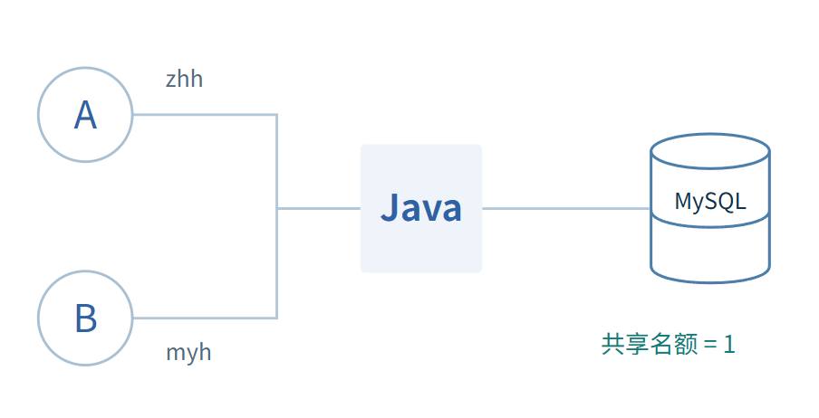

界面负责交互，规则由后端判断，记录由数据库保存。

## 目录

- [零、课前准备清单（建议例会前提前完成）](#before)
- [一、今天这节例会要做什么？](#roadmap)
- [二、网页也能存数据，为什么还要后端？](#demo)
- [三、点下“报名”之后，后端到底在忙什么？](#backend)
- [四、准备动手！先认清这次要用的工程和工具](#setup)
- [五、打开IDEA，先把完整工程认一遍](#terminal)
- [六、准备好数据库连接，把完整后端启动起来](#database)
- [七、拓展阅读：报名记录在数据库里是什么样？](#sql)
- [八、打开前端，先完成一次真实报名](#java)
- [九、打开Apifox，看看“报名”到底发了什么](#apifox)
- [十、给完整工程加个新接口，再修一个“查不到”的错误](#new-api)
- [十一、把检查交给脚本，再聊聊AI怎样参与开发](#extend)
- [环境配置教程：把工具装好，跟着步骤检查一遍](#environment)
- [十二、卡住了怎么办？顺着报错找一找](#faq)
- [项目入口与参考](#resources)

<a id="article"></a>

<a id="before"></a>

## 零、课前准备清单（建议例会前提前完成）

这份指南面向第一次接触后端的读者。前端用VS Code启动，Java后端在IntelliJ IDEA运行与调试，数据库由课前脚本准备；Apifox负责发送HTTP请求。IDEA数据库工具和SQL放在拓展中。

现场网络和安装速度不一定稳定，请尽量在例会前完成下面的准备。点击蓝色项目名称，直接跳到本页内置的图文教程；每节末尾都有验证方法，装到哪一步算完成也写在里面。

1. [整理项目材料，准备浏览器](#prep-files)，保留完整目录，显示文件扩展名，记清本课端口。

2. [下载JDK 21，配置JAVA_HOME与Path](#prep-jdk)，选择Windows x64的JDK MSI，验证java和javac。

3. [安装IntelliJ IDEA，完成初始配置](#prep-idea)，选对桌面安装包，设置Project SDK、UTF-8、Maven与所需插件。

4. [安装MySQL 8.4，配置并启动服务](#prep-mysql)，设置管理员密码、端口和Windows服务；按需补Visual C++运行库。

5. [运行数据库准备脚本，核对完整工程连接](#prep-database)，准备signup_demo和演示数据，保存自己的连接信息；IDEA手动SQL可选。

6. [安装VS Code与Live Server](#prep-vscode)，分别打开联调前端与纯前端，确认5500和5501。

7. [安装Git，配置提交姓名与邮箱](#prep-git)，用于版本管理和协作；直接拿到本地工程也能先完成核心实操。

8. [安装Apifox桌面版，导入课堂接口](#prep-apifox)，导入现有OpenAPI文件，配置本机练习环境。

9. [做一次课前验收，带好电脑与充电器](#prep-check)，用结果核对环境；遇到问题记下步骤和报错，课堂一起处理。

新装统一使用JDK21、MySQL8.4；已有可用环境先按教程核对。安装与下载依赖尽量课前完成，数据库准备脚本尽量课前跑完，例会上一起启动完整工程、调试接口。

<details>
<summary>本课使用哪些工程，哪些软件不用额外安装？</summary>

直接使用材料目录中的项目，不用重新创建工程。下文用D:\signup-class举例，没有D盘就放到自己的其他目录。

| 文件夹 | 使用方式 |
| --- | --- |
| material/项目工程/前后端/backend | 主线实操：在IDEA运行完整后端，端口8080 |
| 项目/练习工程 | SQL填空拓展：8081、signup_lab，不是本次主线 |
| material/项目工程/前后端/fronted | VS Code打开，向真实后端发请求 |
| material/项目工程/内存后端版 | 演示统一处理和重启丢失，8082，不需要MySQL |
| material/项目工程/纯前端版 | VS Code打开，观察页面内存与本地存储 |

前端是原生HTML/CSS/JavaScript，Live Server即可启动；Maven由IDEA或工程Wrapper提供；Java与MySQL驱动由Maven解析。Python、全局Maven、Node.js和Apifox CLI都不属于本次核心实操的必装项。选择数据库拓展时，再在IDEA的数据源窗口下载驱动。

</details>

- [ ] 已按图文教程完成工具配置，并通过课前验收

离线安装包按material中的实际文件选择。当前Mac版IDEA、MySQL和Apifox是ARM版，适用于Apple Silicon；附带的Mac版JDK21是x64版，适用于Intel芯片。Apple Silicon用户请按JDK下载教程另选aarch64版本，Intel用户请下载对应的其他工具版本。

<a id="roadmap"></a>

## 一、今天这节例会要做什么？

先看看“能打开、能登录、能保存”离一个多人使用的系统还有多远。先用三个版本观察差别，后半段一起启动完整工程，再用Apifox发请求、传参数和修一个错误。

| 阶段 | 一起做什么 | 你会学到什么 |
| --- | --- | --- |
| 从网页说起 | 在纯前端报名，用F12查看代码和本地数据 | 分清浏览器能保存什么，以及哪些规则不能只靠页面决定 |
| 给网页接上后端 | 对比内存后端和数据库后端 | 看懂统一处理请求、共享数据和持久化的区别 |
| 把完整工程跑起来 | IDEA启动Java，VS Code打开前端 | 配好连接，走通一次登录和报名 |
| 打开Apifox | 登录取token、报名取ID，再查询记录 | 认识方法、参数、认证与响应，学会让请求传递数据 |
| 给接口加个功能 | 在完整工程新增入口，用断点找出错误参数 | 沿着请求和变量排查问题，再验证修改结果 |
| 继续试一试 | 跑自动检查，了解SDD | 把要实现的行为写成可以检查的条件 |

SQL、建表和原来的两句SQL填空都保留在拓展中，想弄清底层读写时再展开。主线直接使用已经写好的完整工程，不要求从零搭数据库或手写查询。

<a id="demo"></a>

## 二、网页也能存数据，为什么还要后端？

报名页面已经能登录、能显示名额，看起来挺像一个完整系统。先别急着看Java代码，我们从浏览器里能观察到的东西开始。

### 1. 先登录，看看纯前端已经能做什么

VS Code打开 `material/项目工程/纯前端版`，用Live Server在5501启动。点击“填入 zhh”或“填入 myh”，密码都是demo123。页面可以报名，也可以注册新账号。

这个版本把新账号保存在当前浏览器的localStorage中，密码保存为带盐哈希；报名记录放在当前页面的JavaScript内存里。因此，新注册的账号刷新后还在，报名刷新后却消失。同一页退出再登录时，页面内存可能还在，观察时记得真的刷新一次。

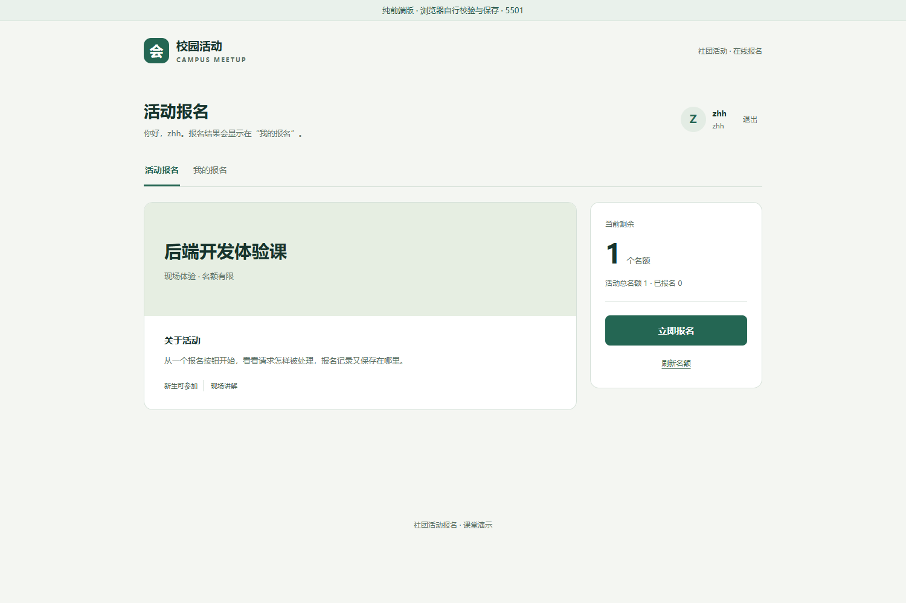

当前纯前端页面：登录和报名都可以在浏览器中完成。

能保存在自己的电脑上，确实适合做个人草稿、主题偏好等功能。接下来要问的是：当许多人一起用、而且每个人都能操作自己的浏览器时，谁来确认账号和最后一个名额？

### 2. 按一下F12，原来这些代码都能看到

在刚才的纯前端页面按F12，打开开发者工具。笔记本可能需要Fn+F12，也可以按 `Ctrl+Shift+I`。

1. 在开发者工具获得焦点后，按 `Ctrl+Shift+F` 打开全局搜索。

2. 输入 `demo123` 并回车，在结果里找到app.js，点击包含密码判断的结果。

3. 留意 `password==='demo123'` 这一段，以及附近的演示账号信息。这里不是从数据库查到密码，而是浏览器已经下载了这段纯前端校验代码。

4. 再搜索 `APP_CONFIG`，打开config.js，可以看到mode、apiBase和eventId等配置。也可以在Sources中按 `Ctrl+P`，输入app.js或config.js直接打开。

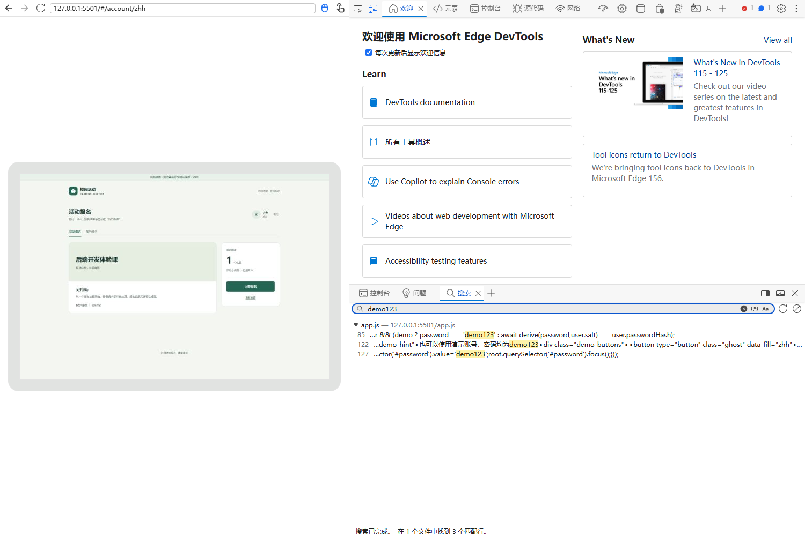

实际Edge开发者工具：全局搜索demo123，在app.js中找到浏览器下载的演示校验代码。

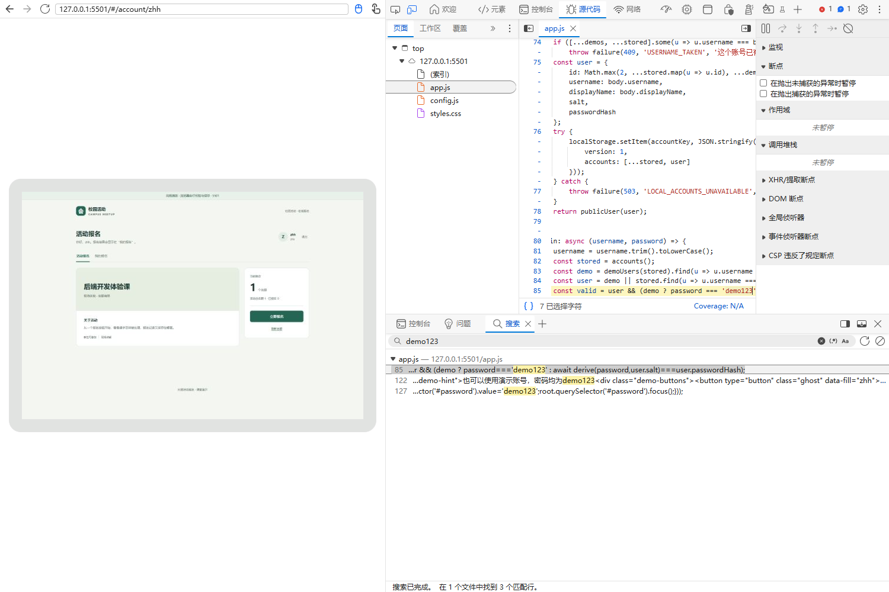

点击搜索结果，Sources定位到app.js的登录判断。图中高亮的是纯前端演示密码判断。

本项目故意使用公开的演示账号，方便对比。真正要记住的是：交给浏览器执行的代码，使用者就能查看和修改。把密码判断、管理员权限或服务端密钥藏在JavaScript里，不能形成可靠的权限边界。压缩代码也不会改变这一点。

接口地址本来就可以公开，apiBase能被看到是正常的。安全与否，要看服务端是否独立验证身份和业务规则，不能只凭“F12能搜到配置”来判断。[开发者工具全局搜索说明](https://developer.chrome.com/docs/devtools/search)

### 3. localStorage也能看到，不是一个隐藏的保险箱

切到Application（应用）→ Storage（存储）→ Local Storage，点开当前页面的 `http://127.0.0.1:5501`。如果还没有注册过新账号，可以先在页面注册一个自己的账号，再回来刷新存储列表。

找到 `signup-classroom-accounts-v1`，展开里面的accounts。你会看到账号名、称呼、salt和passwordHash。这里看到的是哈希，不是新注册账号的明文密码；但这些内容仍保存在本机，也能被本机使用者编辑或清理。演示账号内置在代码里，没有出现在这个键里也正常。

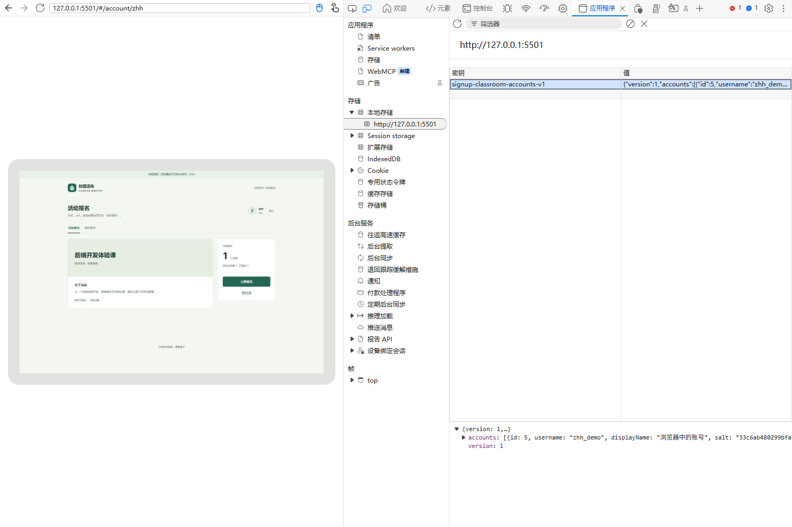

Application → Local Storage：新注册账号位于当前浏览器，包含salt与passwordHash，不是明文密码。

前端保存个人偏好没有问题。对于所有人的账号、权限和共享名额，我们需要一个由服务端掌握的依据，而不能把当前浏览器提交的内容直接当作事实。[本地存储的安全边界](https://cheatsheetseries.owasp.org/cheatsheets/HTML5_Security_Cheat_Sheet.html)

### 4. 先接一个后端：用Java内存统一处理

打开 `material/项目工程/内存后端版/pom.xml`，在IDEA运行SignupApplication，然后访问 `http://127.0.0.1:8082/`。这个版本不连接MySQL，账号、活动和报名由Java进程中的集合保存。页面顶部会标明“内存后端”。

用两个相互隔离的浏览器会话分别登录zhh、myh，都先停在“剩余1”，再提交报名。两边现在请求同一个后端，只能有一个人成功，另一人会看到名额已满。纯前端版的两个页面则各算各的，可以都显示成功。

### 两种名额判断的结果

两人提交前都看到剩余 1 个名额，比较以下两种处理方式。

| 处理方式 | zhh先报名 | myh随后报名 | 结果 |
| --- | --- | --- | --- |
| 各自的页面内存 | 当前页面显示成功 | 另一个浏览器也显示成功 | 两个浏览器各自判断，都认为自己报上了 |
| 统一检查名额 | 服务端确认报名成功 | 服务端返回名额已满 | 同一份名额只接受一次成功报名 |

可以在纯前端版和内存后端版中分别操作，核对实际结果。

内存后端已经能统一校验和共享名额，并不需要先有数据库才算后端。我们再观察它能把记录保留多久。

### 5. 刷新没丢，重启Java以后呢？

先用myh在内存后端完成报名，打开“我的报名”，记下活动和报名编号。刷新网页、重新登录，记录还在，因为Java进程一直没有停止。

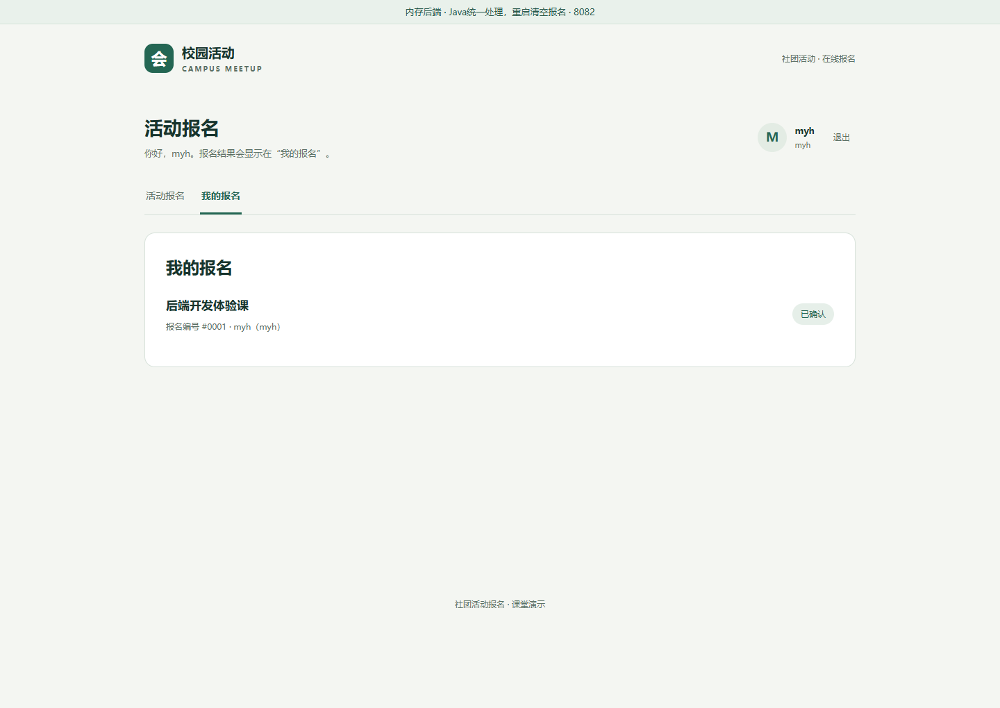

内存后端8082：myh报名后能查看记录，刷新网页也仍然存在。

接着在IDEA停止8082的进程，再启动同一配置。回到网页重新登录myh，再打开“我的报名”：刚才的记录没有了，活动1的名额也恢复为1。

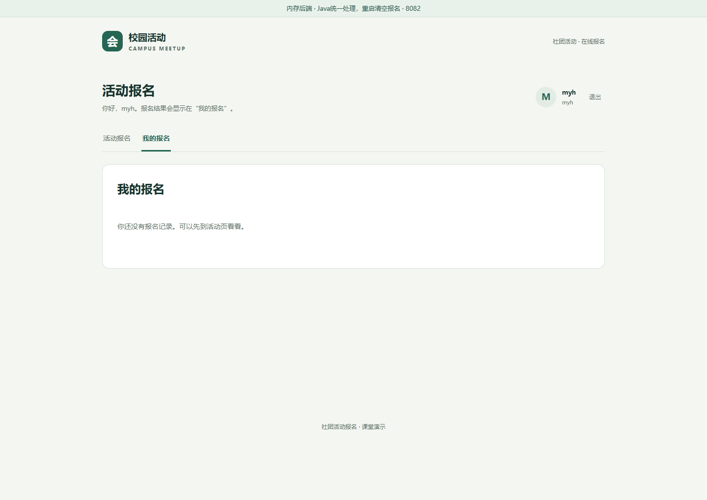

只重启内存后端Java，再登录myh：我的报名为空。

这次丢的是Java进程中的数据。重新登录只是为了让请求通过身份校验，不会帮我们恢复报名。这个演示版没有把集合写入磁盘，所以重启会重新初始化；内置演示账号会回来，新注册的账号也会消失。

### 6. 再接上数据库，让报名记录留下来

最后切到完整工程的数据库后端。页面操作保持相同，业务请求交给Java处理，账号和报名写入MySQL。完成报名后，只重启Java，重新登录仍能查到同一条记录。

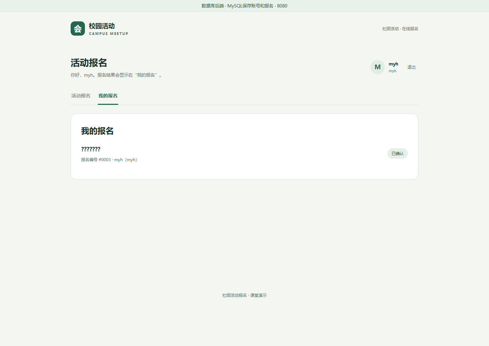

完整数据库后端：报名记录已保存，记下当前编号。


只重启完整后端Java，再登录同一账号：仍能查回相同编号的报名。

| 版本 | 谁判断报名规则 | 数据放在哪里 | 刷新网页 | 重启Java |
| --- | --- | --- | --- | --- |
| 纯前端 | 当前浏览器 | 新账号在localStorage，报名在页面内存 | 新账号保留，报名消失 | 没有Java后端 |
| 内存后端 | 同一个Java服务 | Java进程内存 | 后端仍运行时，报名保留 | 新账号和报名消失，演示账号重新初始化 |
| 数据库后端 | Java服务 | MySQL业务表 | 报名保留 | 重新登录后，报名仍保留 |

这里得到了两个不同的结论：后端负责统一处理可信的身份与规则，数据库负责保存需要持久化的业务数据。数据库连接密码、服务端密钥等配置仍留在服务端环境中，不会因为用了数据库就自动变安全，也不需要一股脑写进业务表。

例会上先看这三种版本的效果，后面的动手环节直接使用完整工程。数据库的建表和SQL原理可以课后展开拓展阅读。

后端就是运行在服务端、接收请求并处理业务的程序。它可以使用内存，也可以访问数据库；我们通常让需要长期保存的账号、活动和报名记录进入数据库。

- [ ] 我能说明纯前端、内存后端与数据库后端分别解决了什么问题

<a id="backend"></a>

## 三、点下“报名”之后，后端到底在忙什么？

前面看过三种存储方式，下面的结构图以数据库完整工程为例；内存后端把最后一站换成Java进程内的集合。

刚才我们点了一个按钮，就完成了报名。但页面上看不到的地方，还有程序在确认账号、检查名额、保存记录。下面就跟着一次报名请求，看看这些工作分别由谁完成，也认识一下后面要用的Java和Spring Boot。

### 1. 一次报名，要经过哪几站？

先回到刚才的页面：你看到的活动介绍、剩余名额和按钮属于前端。点击“立即报名”后，浏览器会把报名请求发给后端；后端确认当前账号、检查活动名额，再通过数据库查询或写入记录，最后把结果返回给页面。

**一条报名请求的经过**

1. 浏览器把点击转换成HTTP请求，发给Java后端。
2. 后端确认登录身份，检查重复报名和剩余名额。
3. 数据库版通过MySQL读取、保存报名记录。
4. 后端返回处理结果，页面显示报名成功或失败。

Apifox也能直接向同一后端接口发送请求。接口是请求入口。

| 位置 | 在报名系统里做什么 | 你刚才看到的效果 |
| --- | --- | --- |
| 前端：浏览器里的页面 | 展示活动，接收点击，把请求发出去，再显示返回结果 | 登录表单、“立即报名”按钮、“我的报名”页面 |
| 后端：运行中的Java程序 | 确认是谁在报名，判断是否重复、是否还有名额，并读写数据 | 两个账号争同一个名额时，统一决定谁能成功 |
| 数据库：MySQL | 按SQL保存和查询账号、活动、报名记录 | 刷新页面、重新登录后，还能查到原来的报名 |

这里的“后端”指运行在服务端、接收请求并处理业务的程序。开发时，页面、Java程序和MySQL都可以运行在你自己的电脑上，它们承担的是不同工作，不一定是三台电脑。以后部署到服务器，基本的配合方式仍然相同。

### 2. 网页怎么找到后端？认识一下“接口”

“我要报名”需要有一个具体入口，浏览器才能把请求发到正确的地方。这个入口就是我们说的接口：约定好向哪个地址发送请求、用什么方法、带哪些信息，以及后端返回什么结果。

比如给编号为10的活动报名，可以发送下面这个请求。这里的10是后面接口练习使用的活动编号，刚才开场演示用的是活动1。

```http
POST /api/events/10/registrations
Authorization: Bearer <本次登录得到的token>
Content-Type: application/json
{}
```

 

先看懂其中几个地方：`POST`表示这次提交报名，地址中的 `10`指出报哪场活动，`Authorization`带上登录后拿到的token，让后端识别当前账号。成功时，后端返回201和报名ID；重复报名或名额已满时，会返回409，并用不同的 `code` 说明原因。

网页按钮会替我们组织并发送这条请求。后面用到的Apifox，则让我们直接填写地址和参数、发送请求、查看返回结果。这样即使页面还没写好，也能先检查接口；出错时，也更容易看清是哪一部分没有对上。

### 3. 后端都用什么语言？这次为什么选Java？

接收请求、判断名额、读写数据库，这些工作可以用不同的编程语言完成。Java、Python、Go、C#都能写后端；之前接触过的JavaScript，也可以借助Node.js运行在服务端。

先从这张开发者调查里认识一些常见语言。它统计开发者过去一年使用过的语言，前端、数据处理等用途也包含在内。关注下大家都在用什么语言

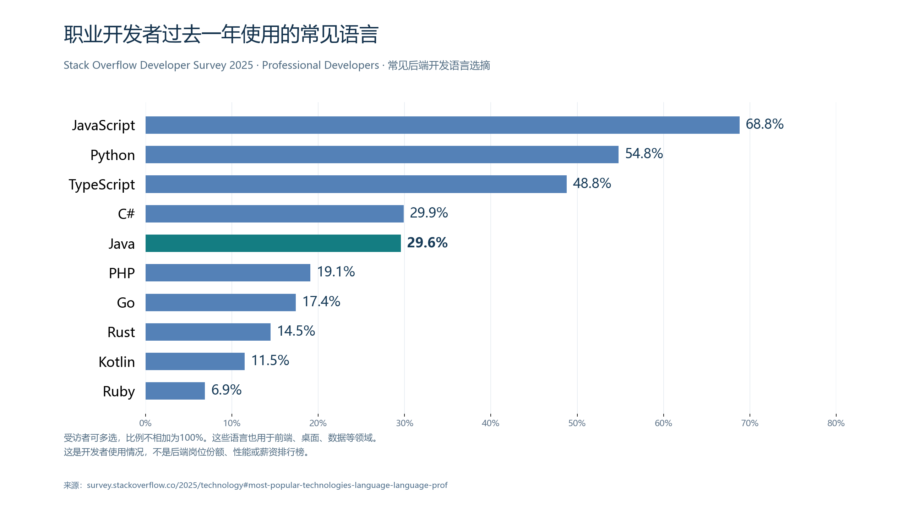

<details>
<summary>JetBrains与W3Techs</summary>

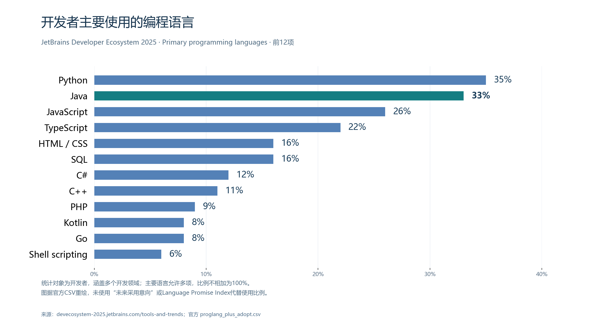

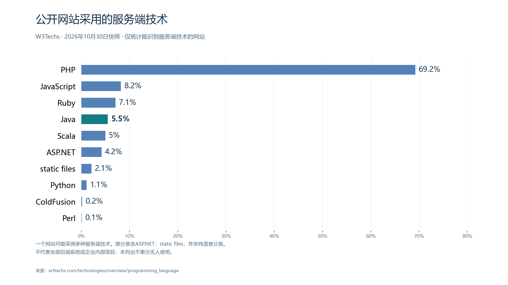

</details>

这次我们沿用现成的Java工程，围绕同一个报名系统，把SQL接进程序，再添加一个接口。暂时不用记住Java的全部语法，先能找到变量、方法和参数，看懂它们怎样参与一次报名就够了。Go也能做类似的后端服务，后面换语言时仍然可以沿用这些接口与数据的思路。

### 4. Java和Spring Boot，到底是什么关系？

这些名字出现在同一个工程里，各自负责的事情不同。先顺着图看：网页请求进来后，由Spring MVC找到处理方法，业务代码判断能不能报名，再借助JdbcTemplate访问MySQL。

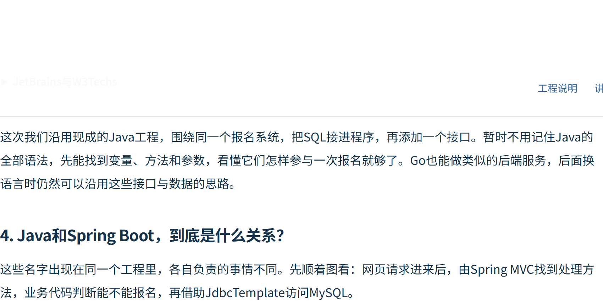

Java用于编写应用；Spring Boot负责启动和配置；请求经过应用组件，再访问独立的MySQL服务。点击图片可查看大图。

| 名字 | 用通俗的话说 |
| --- | --- |
| Java | 写后端程序的语言。“已经报过就返回提示”“还有名额才允许报名”，都要用它写成代码。 |
| Spring Boot | 帮你把应用开起来：读取配置、启动服务，并根据引入的组件完成常用配置。报名规则仍然由我们写。 |
| Spring MVC | 负责接待和分发网页请求：看请求的地址、方法，找到对应的Java方法，处理后再把结果返回。 |
| JdbcTemplate | Java访问数据库时的帮手。我们提供SQL和参数，它配合数据库连接与驱动执行操作，并帮忙读取返回结果。 |
| SQL | 发给数据库的操作指令，比如“查询这场活动”或“新增一条报名”。后面会亲手写这样的语句。 |
| MySQL | 真正保存和查询记录的数据库软件。它收到SQL后执行操作，把查到的数据或执行结果返回给程序。 |
| @PostMapping | 贴在Java方法上的“入口标记”，告诉Spring MVC：这个地址的POST请求交给这个方法处理。 |

放回刚才的报名操作：Java写出报名规则，Spring Boot让应用运行起来，Spring MVC把请求交给相应的方法，JdbcTemplate帮助执行SQL，MySQL保存记录。下一次查询“我的报名”时，又会沿这条流程把记录取回来。

<details>
<summary>顺手认识一下：其他语言常用什么搭配？</summary>

| 语言 | 常见搭配 | 可以怎样理解 |
| --- | --- | --- |
| Java | Spring Boot | 本次报名系统使用的搭配 |
| Python | Django、FastAPI | 用Python编写Web应用或接口服务 |
| JavaScript / TypeScript | Node.js，常配Express或NestJS | 使用熟悉的JavaScript语法开发服务端程序 |
| Go | 标准库net/http、Gin | 用Go接收HTTP请求、实现后端接口 |
| C# | ASP.NET Core | .NET生态中的Web应用与接口开发 |

Node.js是运行环境，Spring Boot、Django等提供应用开发所用的框架与组件；不用把这些名字都当成新的编程语言。想进一步看看Java方法怎样接到HTTP地址上，可以阅读[Spring官方接口入门示例](https://spring.io/guides/gs/rest-service/)。

</details>

### 5. 一个后端项目，通常是怎么做出来的？

如果现在要从头做这个报名系统，第一步要先说清楚规则：谁能报名、允许报几次、名额满了怎么办。接着才是约定数据和接口、写代码，再把各部分接起来检查。这也是长期以来后端开发常见的工作顺序。

| 开发环节 | 放到我们的报名系统里做什么 |
| --- | --- |
| 明确需求 | 确定需要登录、同一账号不能重复报名、最后一个名额只能被一人拿到 |
| 设计数据和接口 | 准备账号、活动、报名三张表；约定报名地址、输入与返回内容 |
| 编写程序 | 实现登录、名额判断与数据库访问，把规则写进Java代码 |
| 联调与测试 | 在网页上试报名，用Apifox检查请求，再去MySQL核对记录；重复报名和满员也要试 |
| 评审、发布与维护 | 用Git记录修改、通过PR讨论代码；发布后继续看日志、处理问题 |

实际开发会在这些环节之间来回调整。比如调接口时发现参数不好用，就回去改约定；发现数据库记录不对，就继续检查SQL和业务代码。

AI可以帮忙整理需求、生成代码和准备测试，但报名规则仍要写清楚，结果也要实际核对。结尾会再认识SDD：先把需求和验收写成规格，再据此组织实现与检查。

接下来，我们就把这张流程表落到自己的电脑上：先让MySQL服务运行起来，再用IDEA连接数据库、导入数据，看看程序要保存的记录究竟长什么样。

### 6. 后端只给网页用吗？

手机App、游戏客户端和桌面软件也可以向服务端请求登录、读取存档或同步数据。网页和Apifox只是今天的两个调用方；这次用HTTP接口理解过程，实际项目也可能使用其他通信方式。

<a id="setup"></a>

## 四、准备动手！先认清这次要用的工程和工具

前面的三个版本用来说明问题。接下来一起操作的是 `material/项目工程/前后端/backend`：前后端、数据库读写和已有接口都已写好，先运行，再调试。

| 工具或版本 | 接下来用它做什么 |
| --- | --- |
| IDEA | 打开完整Java工程，运行、看日志和打断点 |
| VS Code与Live Server | 打开前端联调版，使用5500 |
| MySQL | 保存完整工程的账号、活动和报名 |
| Apifox | 直接向8080后端发送请求，检查响应 |
| 内存后端8082、纯前端5501 | 回看前半段演示，不用于后面的接口实操 |

先按[课前准备清单](#before)安装环境。MySQL服务应已运行，数据库准备脚本也应执行成功；还没完成的话，跳到[数据库准备与启动](#database)跟着操作。这里先不讲SQL语法。

完整工程使用8080与signup_demo；前端联调页使用5500，apiBase指向8080。原来的练习工程8081、signup_lab保留给SQL填空拓展，别把两套窗口和连接混在一起。

<a id="terminal"></a>

## 五、打开IDEA，先把完整工程认一遍

### 1. 打开现成工程，等Maven同步完成

在IDEA欢迎页点Open，选 `material/项目工程/前后端/backend/pom.xml`，作为项目打开。也可以打开完整工程文件夹，再加载pom.xml。等依赖同步完成，确认Project SDK为JDK21，Maven也使用这个JDK；具体入口见[IDEA配置教程](#prep-idea)。

本次先使用已经补齐的代码，看到SignupRepository中的SQL也不用修改。原来的练习工程另有空位，想练SQL时再打开。

### 2. 找到启动入口，再分清三个窗口

| 位置 | 现在先知道什么 |
| --- | --- |
| SignupApplication.java | 找到main方法，从这里运行Java |
| SignupController.java | 已有的注册、登录、报名和查询入口 |
| SignupService.java | 判断重复报名、剩余名额等规则 |
| SignupRepository.java | 已经写好的数据库读写 |
| 课堂文件/ | 稍后新增接口的错误版和参考答案 |

Terminal用来运行系统或脚本命令；Run/Debug Console用来看Java日志与断点；Database的Query Console用来执行SQL，主线里暂时不用打开它。

- [ ] 我已打开完整工程，找到启动类、控制器与运行窗口

<a id="database"></a>

## 六、准备好数据库连接，把完整后端启动起来

这一节的目标是让工程能连接自己的MySQL。建库、建表和演示数据交给提供的脚本完成，暂时不用手写SQL；原理放在后面的拓展中。

### 1. 双击运行数据库准备脚本

先确认MySQL服务已启动，记好端口和管理员密码。完整解压material文件夹，打开其中的**快速启动**文件夹，双击**运行数据库准备.cmd**。

1. 出现“MySQL管理员密码”提示时，输入自己的MySQL管理员密码，按回车。

2. 出现“workshop数据库密码”提示时，如果账号已经存在，输入原密码；首次创建时，在这里设置密码并记住。Java后端连接数据库时会用到它。密码输入时隐藏是正常现象。

3. 看到zhh、myh和“准备完成”后，数据库就准备好了。确认执行结果后，按任意键关闭窗口；如果出现错误，先保留窗口中的错误信息。

启动文件会调用同目录下的课前准备数据库.ps1，并根据脚本位置寻找项目工程/前后端/backend/sql中的SQL文件。保持material内部目录结构，整套文件夹可以解压到自己的目录中使用。

脚本会准备signup_demo、所需表和演示账号。已有账号、密码和报名记录会保留。此前已经创建过workshop的，仍需要填写它原来的密码。

<details>
<summary>通过PowerShell运行，或指定其他MySQL路径、端口</summary>

在material/快速启动文件夹中打开PowerShell，执行下面的命令。

```powershell
powershell -NoProfile -ExecutionPolicy Bypass -File ".\课前准备数据库.ps1"
```

 

找不到mysql.exe时，用`-MysqlExe`指定MySQL安装目录中bin下的mysql.exe完整路径。连接地址或端口需要调整时，用`-DbHost`和`-DbPort`传入实际值。

</details>

MySQL管理员密码和workshop密码属于数据库连接配置，网页登录的演示密码demo123用于报名系统登录。

### 2. 配好Java运行时的数据库连接

在IDEA顶部找到SignupApplication，点击右侧下拉箭头，选择“编辑配置”。已有运行配置可以直接打开；首次运行时，点击SignupApplication.java中main方法旁的绿色三角创建配置。

检查Java版本为JDK21，主类为`cn.meeting.signup.SignupApplication`。点击右上角“修改选项”，勾选“环境变量”，让输入框显示出来。不同版本的IDEA显示字段有所差别，工作目录通常沿用自动生成的backend目录。

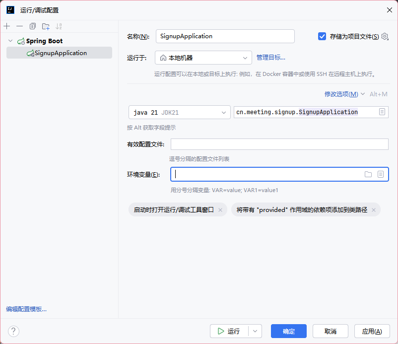

Spring Boot运行配置中的环境变量输入框。在这里填写Java后端连接MySQL所需的信息。

按前一步脚本准备的数据库，添加下面三项即可。

| 名称 | 值 |
| --- | --- |
| `DB_USER` | `workshop` |
| `DB_PASSWORD` | 运行准备脚本时输入的workshop数据库密码 |
| `DB_INIT` | `never`，脚本已准备好表和演示数据 |

点击环境变量输入框右侧的编辑按钮，可以在表格中逐项添加。也可以直接在输入框填写`DB_USER=workshop;DB_PASSWORD=你的workshop密码;DB_INIT=never`，再替换实际密码。密码包含分号时，使用表格填写。

<details>
<summary>数据库地址、端口或名称与默认值不同，在哪里修改？</summary>

项目默认连接本机3306端口的signup_demo数据库，后端使用8080端口。如果准备脚本使用了其他地址、端口或数据库名称，再添加相应变量覆盖默认值。

| 名称 | 默认值 |
| --- | --- |
| `DB_HOST` | `127.0.0.1` |
| `DB_PORT` | `3306` |
| `DB_NAME` | `signup_demo` |
| `SERVER_PORT` | `8080` |

</details>

运行配置中如果勾选了“存储为项目文件”，填写的环境变量也可能写进项目配置文件。课堂材料需要分享给别人，运行配置中的真实数据库密码应保留在自己的电脑上，分享前检查配置文件。

点击“应用”后运行，打开`http://127.0.0.1:8080/health`，应看到`{"status":"ok"}`。这个接口确认Java服务已启动。接着在前端使用zhh或myh登录，加载活动并完成报名，验证实际的数据读写。

### 3. 在右侧Database连接MySQL，看看数据落在哪里

Java运行配置让报名程序连接MySQL；IDEA右侧的Database让我们直接查看数据表、执行SQL。这两个连接各自配置。右侧显示“无数据源”时，可以按下面步骤添加可视化连接。

1. 点击IDEA右侧的Database图标，点击面板中的“创建数据源”，或左上角的“+”，选择“数据源 → MySQL”。

2. 按下表填写连接信息。如果出现“下载缺失的驱动文件”，点击下载并等待完成。

3. 点击“Test Connection / 测试连接”，成功后点击“应用 → 确定”。

| 界面字段 | 填写内容 |
| --- | --- |
| Host / 主机 | `127.0.0.1`，与Java配置一致 |
| Port / 端口 | `3306`，或自己实际使用的端口 |
| User / 用户 | `workshop` |
| Password / 密码 | 前一步脚本使用的workshop密码 |
| Database / 数据库 | `signup_demo` |

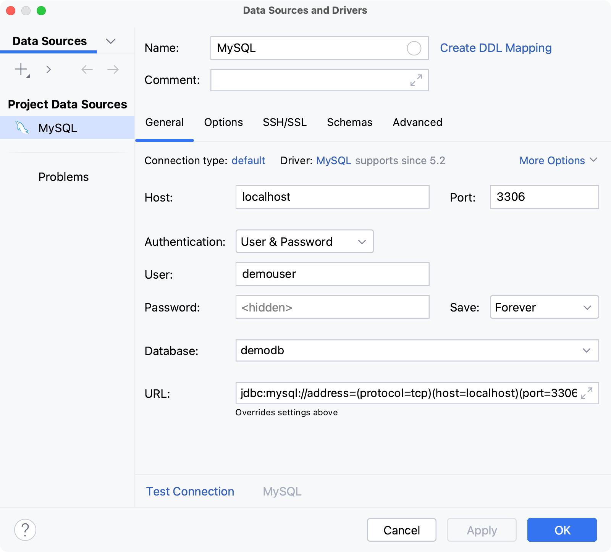

IDEA的MySQL数据源窗口；本课先用root和自己的密码，初次可不填Database。 [JetBrains官方界面图](https://www.jetbrains.com/help/idea/mysql.html)

展开连接下的`signup_demo → tables / 表`，会看到`users`、`events`和`registrations`。如果看不到signup_demo，点击连接名称旁的架构数量或“未选择架构”，勾选signup_demo并刷新。

先双击users查看预设账号，再到网页完成一次报名，回到IDEA双击registrations。表格已经打开时，点击数据表工具栏的刷新按钮，读取最新记录。根据user_id对应users中的账号，根据event_id对应events中的活动，就能把网页操作与数据库记录联系起来。页面显示的名额和报名结果，都有了可以核对的数据。

如果使用的IDEA授权不支持Database工具，可以继续通过网页“我的报名”和Apifox检查后端返回的记录。可视化连接步骤用于直接观察数据表。

- [ ] 我已完成数据库准备，完整后端在8080运行

<a id="sql"></a>

## 七、拓展阅读：报名记录在数据库里是什么样？

主线可以直接进入下一节。想理解Java怎样读写MySQL，或课后自己补一遍数据库操作，再展开下面的内容。

<details>
<summary>拓展一：手动确认MySQL服务、终端与连接</summary>

刚才已经看过报名系统的效果，接下来把它接到自己的数据库上。先确认MySQL服务正在运行，再去IDEA里连接；这一步通过，后面才能读写报名记录。

### 1. 工具都准备好了吗？

| 工具 | 接下来用它做什么 |
| --- | --- |
| IntelliJ IDEA | 打开Java工程、运行后端，连接数据库并执行SQL |
| MySQL | 在后台保存账号、活动和报名记录 |
| VS Code与Live Server | 打开前端页面，访问后端接口 |
| Apifox | 稍后直接发送请求，检查接口返回 |

已经按[课前准备清单](#before)配好的环境可以直接往下走。还没完成安装，就先打开对应教程：[JDK21](#prep-jdk)、[IDEA](#prep-idea)、[MySQL](#prep-mysql)、[VS Code](#prep-vscode)。本次前端是原生HTML/CSS/JavaScript，Live Server即可启动。

### 2. 找到MySQL服务，点一下“启动”

按 `Win+R`，输入 `services.msc` 后回车。在服务列表中找到自己的MySQL，名称可能是MySQL84或MySQL80，右键选择“启动”。看到状态变成“正在运行”，说明数据库服务已经起来了；原本就在运行，就不用重复操作。

也可以在PowerShell中查看。已经打开IDEA的话，直接用底部的Terminal输入：

```powershell
Get-Service -Name '*MySQL*'
```

 

输出里会列出服务名称和状态。如果实际名称是MySQL84、状态为Stopped，可以在管理员PowerShell中执行：

```powershell
Start-Service -Name 'MySQL84'
```

 

把示例名称换成自己查到的名称，再确认状态为Running。若查不到MySQL服务，回到[MySQL配置教程](#prep-mysql)完成Configurator中的Windows Service配置。

### 3. 记下端口和数据库账号

接下来连接时要用到三项信息：MySQL端口（通常是`3306`）、管理员账号（通常是`root`），以及安装时设置的密码。先把它们记好，后面在IDEA里连接数据库、给Java工程填配置时都会用到。网页里的zhh、myh是报名系统的业务账号，不能拿来连接MySQL。

#### ① 端口忘了？用命令查一下

确认MySQL服务已经启动，在PowerShell中执行：

```powershell
$mysqlProcessIds = @(Get-Process -Name mysqld -ErrorAction Stop).Id
Get-NetTCPConnection -State Listen |
Where-Object { $_.OwningProcess -in $mysqlProcessIds } |
Select-Object LocalAddress, LocalPort -Unique
```

 

看输出里的`LocalPort`。如果同时看到`3306`和`33060`，本次连接用`3306`；`33060`是另一种协议的端口。如果你的端口改过，后面的命令和IDEA配置也要跟着改。

#### ② 密码记不准？先登录试试

在PowerShell中输入下面这条命令，注意端口用大写`-P`，密码用小写`-p`：

```powershell
mysql -h 127.0.0.1 -P 3306 -u root -p
```

 

看到`Enter password:`后输入密码并回车。输入时不会显示字符或星号，这是正常的。

- 出现`mysql>`：登录成功，账号和密码可以用！输入`exit;`即可退出。

- 出现`ERROR 1045 / Access denied`：认证失败，先检查账号和密码是否输对；账号的访问权限也可能影响登录。

- 出现`ERROR 2003 / Can't connect`：还没连上服务，先检查服务状态和端口。

- 提示无法识别`mysql`：终端没找到客户端。可以先用下面的命令查安装位置，把`MySQL`换成自己查到的服务名称：

```powershell
Get-CimInstance Win32_Service -Filter "Name='MySQL'" |
Select-Object -ExpandProperty PathName
```

 

输出里找到以`mysqld.exe`结尾的路径，例如`C:\Program Files\MySQL\MySQL Server 8.4\bin\mysqld.exe`。去掉最后的`mysqld.exe`，前面的部分就是`bin`文件夹的位置。注意，后面`--defaults-file`指向的是配置文件，不是程序安装目录。

在PowerShell中切换到这个文件夹，再试一次登录。下面路径仅作示例，要换成自己查到的路径：

```powershell
Set-Location -LiteralPath 'C:\Program Files\MySQL\MySQL Server 8.4\bin'
.\mysql.exe -h 127.0.0.1 -P 3306 -u root -p
```

 

如果文件夹里没有`mysql.exe`，说明这里没有安装命令行客户端，可以先在后面的IDEA连接页面用Test Connection验证账号和密码。

<details>
<summary>确实忘记密码了怎么办？展开查看重置步骤</summary>

原密码通常无法直接查出来，可以重新设置，不用重装数据库。下面适用于本机MySQL 8.x，操作前先关闭正在连接数据库的程序。

1. 以管理员身份打开PowerShell，先查看服务的启动路径。把示例中的`MySQL`换成前一步查到的实际服务名称：

```powershell
Get-CimInstance Win32_Service -Filter "Name='MySQL'" |
Select-Object -ExpandProperty PathName
Stop-Service -Name 'MySQL'
```

 

输出中，`mysqld.exe`是服务程序，`--defaults-file`后面是它使用的配置文件。记下这两个路径；如果没有`--defaults-file`，先确认当前实例实际使用的配置文件，再继续。

1. 用记事本新建一个文件，例如`C:\Users\32241\mysql-reset.sql`，写入下面这句SQL。把示例密码换成自己的新密码，保存时选择“所有文件”，确认文件名没有多出`.txt`：

```sql
ALTER USER 'root'@'localhost' IDENTIFIED BY 'ChangeMe_2026!';
```

 

1. 回到管理员PowerShell，用刚才记下的实际路径启动MySQL。下面以8.4为例，程序、配置文件和SQL文件三个路径都要换成自己电脑上的位置，`--defaults-file`放在其他选项前面：

```powershell
& "C:\Program Files\MySQL\MySQL Server 8.4\bin\mysqld.exe" `
--defaults-file="C:\ProgramData\MySQL\MySQL Server 8.4\my.ini" `
--init-file="C:\Users\32241\mysql-reset.sql" `
--console
```

 

1. 等日志出现`ready for connections`，保持这个窗口打开，另开一个PowerShell，用上面的登录命令测试新密码。

2. 确认能登录后，在手动启动MySQL的窗口按`Ctrl+C`，等进程退出。删除保存新密码的`mysql-reset.sql`文件，再恢复服务启动：

```powershell
Start-Service -Name 'MySQL'
```

 

以后如果修改了数据库密码，IDEA和Java工程里的连接配置也要一起更新。操作可对照[MySQL官方密码重置说明](https://dev.mysql.com/doc/refman/8.4/en/resetting-permissions.html)。

</details>

IDEA负责连接和操作数据库，MySQL服务负责实际运行。服务启动、连接信息确认好，就可以去下一步打开工程；后面我们还会在IDEA里点击Test Connection，并执行SQL确认连接。

</details>

<details>
<summary>拓展二：在IDEA手动建库、导表与处理旧库</summary>

接下来给报名记录找一个保存位置。本次实操统一使用 `signup_lab` 数据库，后端端口用8081；完整工程使用的 `signup_demo` 和8080用于对照。跟着操作时，先把练习库准备好即可。

### 1. 在IDEA建立管理员连接

打开View → Tool Windows → Database，点击加号 → Data Source → MySQL，填写：

| 字段 | 怎么填 |
| --- | --- |
| Name | 自己容易认出的名称，例如“本机MySQL管理员” |
| Host | 127.0.0.1 |
| Port | 安装MySQL时设置的端口，通常3306 |
| User / Password | 自己的root或其他管理员账号，以及对应密码 |
| Database | 先留空，下一步会创建业务数据库 |

底部若出现Download missing driver files，点它下载驱动，再点Test Connection。成功后Apply → OK；如果失败，先检查MySQL服务、端口和密码。[找不到Database窗口时看这里](#prep-idea)。


MySQL连接的字段位置。这里先填自己的管理员；稍后再建workshop / signup_lab连接，账号与库名按正文填写。 [官方界面图来源](https://www.jetbrains.com/help/idea/mysql.html)

### 2. 执行00脚本，准备数据库和workshop账号

在Database中右键刚建的数据源，选择New → Query Console。打开项目里的 `sql/00_准备数据库.sql`，把“替换成自己的课堂密码”改成自己设置的数据库密码，保存文件。

将这份SQL的全部内容复制到管理员Query Console，选中全部语句，按 `Ctrl+Enter` 执行。若出现执行范围选择，选择执行全部选中语句。脚本会创建signup_demo和signup_lab，并给workshop账号授予本课需要的权限。

workshop是程序连接数据库时使用的账号。第一次运行会按脚本里的密码创建它；如果账号原来就存在，脚本不会修改已有密码，要继续使用原密码。

### 3. 再建一个连接，这次选signup_lab

再次添加MySQL数据源，名称可填“报名练习库”。Host和Port不变，User改为workshop，Password填它对应的密码，Database填signup_lab。Test Connection成功后保存，在Schemas中勾选signup_lab，让它出现在Database树中。

打开这个数据源的Query Console，逐句执行：

```sql
USE signup_lab;
SELECT DATABASE();
SHOW TABLES;
```

 

SELECT DATABASE()应返回signup_lab。新库暂时没有表，SHOW TABLES没有结果很正常；下一步就把表建出来。

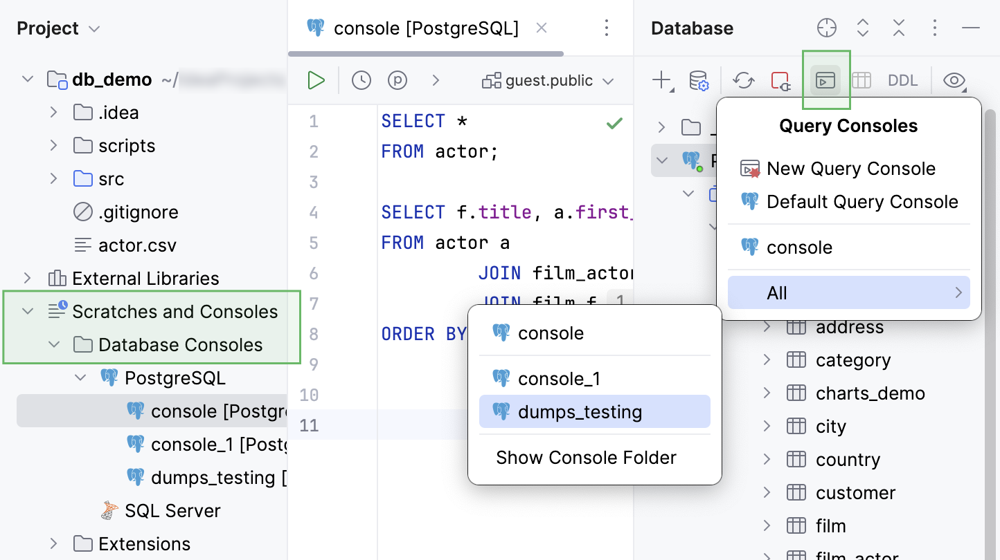

Query Console入口与SQL编辑区域。官方图用PostgreSQL展示布局，本课选择自己的MySQL数据源，无需安装图中的其他数据库。 [官方界面图来源](https://www.jetbrains.com/help/idea/query-consoles.html)

### 4. 执行01和02，把表和演示数据放进去

回到练习工程的sql目录，按顺序执行 `01_schema.sql`、`02_seed.sql`。仍可复制到“报名练习库”的Query Console中执行；先确认顶部的数据源和当前库是workshop / signup_lab。

也可以在Database中右键signup_lab → SQL Scripts → Run SQL Script，先选择01文件运行，完成后再运行02。打开文件或把文件拖进IDEA，只是打开了它，要看到执行结果才算完成。

01创建users、events、registrations三张表；02保留原账号，并新增zhh、myh两个演示账号，以及活动1“后端开发体验课”和活动10“接口练习场”。新库的报名表暂时为空。执行后刷新Database树，再用SQL查看：

```sql
SHOW TABLES;
SELECT id, username, display_name FROM users;
SELECT id, title, capacity FROM events;
SELECT * FROM registrations;
```

 

能看到三张表、演示账号和活动，就可以继续了。脚本不会删除已有记录，沿用旧库时条数可能更多。Query Console若使用Manual事务模式，写入后还要Commit提交；本次可使用Auto模式，让修改直接提交。

<details>
<summary>之前已经用过这个数据库？检查一下注册功能需要的升级</summary>

当前工程支持注册新账号，users表的id需要自增。在signup_lab执行 `SHOW COLUMNS FROM users LIKE 'id';`，查看Extra列是否包含auto_increment。新建的表已经配置好，无需再升级。

旧表缺少这一项时，切到管理员数据源，先执行 `USE signup_lab;`，再完整执行 `sql/03_已有数据库启用注册.sql`。这个脚本保留原有账号和报名，只调整users.id的自增属性；workshop没有ALTER权限，所以需要管理员连接。

如果也使用完整工程的旧signup_demo库，再对该库执行一次。脚本报错时先查看原因；中途停止后可重新连接，再检查自增属性与执行结果。注册若返回503和ACCOUNT_SCHEMA_UPDATE_REQUIRED，就回到这里核对。

</details>

</details>

<details>
<summary>拓展三：认识表、主键与SQL查询</summary>

数据库已经连上了，现在试着跟它“说几句话”。SQL就是告诉数据库要查询或修改什么的语句；这一节用几次查询和一次小练习，认识后面Java代码要操作的数据。

### 1. 先看懂三张表：谁，报了哪一场？

一个MySQL服务里可以有多个数据库，比如signup_demo和signup_lab；一个数据库里又可以有多张表。表中的每一行是一条记录，每一列保存一种信息。

| 表 | 保存什么 | 先留意哪些字段 |
| --- | --- | --- |
| users | 账号信息 | id是账号编号，username是登录账号，display_name是页面上的称呼 |
| events | 活动信息 | id是活动编号，title是名称，capacity是总名额 |
| registrations | 某人报名某场活动的记录 | id是报名编号，user_id指向账号，event_id指向活动 |

#### users

| id | username |
| --- | --- |
| 3 | zhh |
| 4 | myh |

#### events

| id | capacity |
| --- | --- |
| 1 | 1 |
| 10 | 3 |

#### registrations

| id | event_id | user_id |
| --- | --- | --- |
| 57 | 10 | 4 |

关系示例：myh（4）报了活动10，示例报名ID为57。刚导入的真实报名表应为空。

先区分这三个ID：myh的用户ID示例为4，接口练习活动的ID是10，一条报名还有它自己的ID。它们分别回答“谁”“哪场”“哪条记录”，数值不需要相同。图中的57只是示例，实际报名编号以数据库生成的为准。

### 2. 从SELECT开始，把活动查出来

确认现在使用IDEA的signup_lab Query Console。选中一条语句，按 `Ctrl+Enter` 执行，观察下方Result结果：

```sql
SELECT id, title, capacity FROM events;
SELECT id, title, capacity FROM events WHERE id = 10;
SELECT COUNT(*) AS registered_count
FROM registrations
WHERE event_id = 10;
```

 

第一句是“从events里取出这三列”，会看到活动1和活动10。第二句加上WHERE，只看编号为10的活动。第三句用COUNT数这场活动已经有几条报名；新库还没人报名，结果就是0。

试着把第二句里的10换成1，再执行一次，看看活动名称和名额怎样变化。SQL末尾的分号用来结束语句；输入时用英文半角标点。

### 3. 新增一场活动，改改名额，再把它删掉

先查询 `SELECT * FROM events WHERE id = 99;`，确认99号没有被使用，再依次分段执行下面的语句。已有99号时，换一个未使用的编号，并让后续语句使用同一编号。

```sql
INSERT INTO events(id, title, capacity)
VALUES (99, 'SQL练习', 2);
SELECT id, title, capacity FROM events WHERE id = 99;
UPDATE events SET capacity = 3 WHERE id = 99;
SELECT id, title, capacity FROM events WHERE id = 99;
DELETE FROM events WHERE id = 99;
SELECT id, title, capacity FROM events WHERE id = 99;
```

 

你会依次看到：新增一条名额为2的活动、把名额改成3、最后查不到这一行。这就是新增、查询、修改和删除。这里的UPDATE、DELETE都带着WHERE，让操作只针对刚创建的练习活动。

### 4. 报名表只存ID，怎样查出账号和活动名？

JOIN可以顺着ID把几张表连接起来。执行下面这段，查询myh的报名：

```sql
SELECT r.id AS registration_id, u.username, e.title
FROM registrations r
JOIN users u ON u.id = r.user_id
JOIN events e ON e.id = r.event_id
WHERE r.user_id = (SELECT id FROM users WHERE username = 'myh');
```

 

r、u、e是给表起的简短别名，ON后面写出表之间怎样对应。还没有报名时，结果为空；完成下一节网页报名后，再来执行，就能看到报名编号、myh和活动名称出现在同一行。

<details>
<summary>顺手认识：主键、外键和唯一约束在帮我们做什么？</summary>

主键PRIMARY KEY让每条记录有唯一编号。users.id和registrations.id会自动生成，events.id在本课脚本中直接指定；BIGINT、INT存整数，VARCHAR存文字。

registrations里的user_id、event_id是外键，要求所指的账号和活动实际存在。`UNIQUE(event_id,user_id)`则规定同一个账号在同一场活动只能有一条报名。总名额还需要后端检查，并配合事务处理；只有“同一个人不能报两次”的约束，无法单独保证整场活动不超额。

</details>

- [ ] 我会用SQL查活动、修改指定记录，也能区分用户ID、活动ID和报名ID

</details>

<details>
<summary>拓展四：在旧练习工程补两句SQL，观察Java怎样读写</summary>

这部分使用旧的练习工程8081、signup_lab；与主线完整工程8080不同，仅供课后练习。

刚才在Console里执行SQL，是我们直接操作数据库。这一节把SQL交给Java，让页面上的点击也能完成同样的读写。后端在IDEA运行，前端继续由VS Code打开。

### 1. 告诉IDEA：启动哪个程序，连接哪个数据库

打开 `SignupApplication.java`，找到main方法。点击左侧运行图标创建配置，再进入Run → Edit Configurations检查；也可以点加号，新建Application配置。

| 设置 | 本次填写 |
| --- | --- |
| Name | 报名练习后端，或自己容易认出的名称 |
| Main class | cn.meeting.signup.SignupApplication |
| Use classpath of module | 当前练习工程的signup-classroom模块 |
| JRE | Project SDK / JDK21；已有可用JDK25可沿用 |
| Working directory | 练习工程的根目录，也就是pom.xml所在文件夹 |
| VM options / Program arguments | 留空，本次不添加额外参数 |

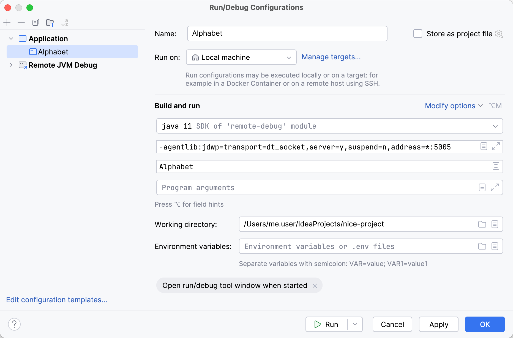

Application运行配置的字段位置。图中的Alphabet、Java11和VM参数是官方示例；本次主类、JDK、工作目录按上表填写，VM参数留空。 [官方界面图来源](https://www.jetbrains.com/help/idea/run-debug-configuration-java-application.html)

找不到模块选择项时，在Modify options中显示Use classpath of module。再显示Environment variables，打开变量编辑表。每行填一个名称和对应值：

| 名称 | 值 |
| --- | --- |
| DB_HOST | 127.0.0.1 |
| DB_PORT | 自己的MySQL端口，通常3306 |
| DB_NAME | signup_lab |
| DB_USER | workshop |
| DB_PASSWORD | 前面为workshop设置的数据库密码 |
| DB_INIT | never |
| SERVER_PORT | 8081 |

这些变量告诉当前Java进程到哪里连接数据库，不需要写进Windows的系统环境变量。DB_INIT用never，因为表和数据已经手动导入；SERVER_PORT是后端HTTP端口，与MySQL端口不同。

保存配置，点击Run。Run Console出现成功启动的日志后，在浏览器打开 `http://127.0.0.1:8081/health`，应返回 `{"status":"ok"}`。这说明Java服务已启动，数据库读写还要用后面的操作验证。

### 2. 先补活动查询，让页面能读到活动

练习工程的两句SQL目前是空字符串。先打开SignupRepository.java，把FIND_EVENT_SQL那一行改成：

```java
private static final String FIND_EVENT_SQL = "SELECT id, title, capacity FROM events WHERE id = ?";
```

 

这和上一节查询活动的SQL很像，只是把固定编号换成了问号。程序会把本次请求的活动ID传给它，所以同一句SQL既能查询活动1，也能查询活动10。

保存后，在IDEA停止旧进程，再Run同一个运行配置，让修改后的代码重新编译并运行。后面每次改Java代码，都按这个顺序操作；如果启动的是旧JAR，改动还不会出现在运行中的服务里。

<details>
<summary>刚才尝试登录，却又回到了登录页，是哪里没接上？</summary>

当前页面会在登录成功后立即读取活动。FIND_EVENT_SQL留空时，这次活动请求会返回501和LAB_SQL_REQUIRED，页面提示先填写FIND_EVENT_SQL，再回到登录入口。这是练习工程留下的步骤。

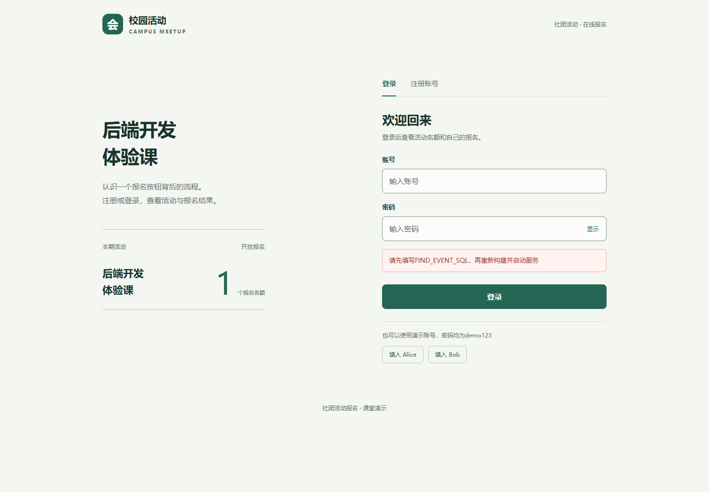

当前练习工程的实际提示：活动查询SQL留空时，登录后的活动读取失败，页面会回到登录入口。

补好查询SQL、重新运行后再登录即可。仅访问health得到ok，不能说明活动查询已经完成。

</details>

### 3. 用VS Code打开前端，先登录看看

VS Code单独打开 `material/项目工程/前后端/fronted` 文件夹，检查config.js：

```javascript
window.APP_CONFIG = { mode:'api', apiBase:'http://127.0.0.1:8081/api', eventId:1 };
```

 

右键index.html → Open with Live Server，浏览器应在 `http://127.0.0.1:5500/index.html` 打开页面。5500负责网页，8081负责接口；apiBase把二者接起来。工程已允许本机5500前端访问后端，若Live Server换了端口，先检查占用并恢复5500。

点击“填入 myh”，再点“登录”。这时应能看到活动1“后端开发体验课”和剩余名额。如果用的是完整后端8080，前端apiBase也要对应8080；本节继续使用练习后端8081和signup_lab。

### 4. 点一次报名，再补上写入SQL

在还有名额时点击“立即报名”。第一次会提示先填写INSERT_REGISTRATION_SQL，数据库里也不会多出这条报名。活动能查到了，接下来把写入补上：

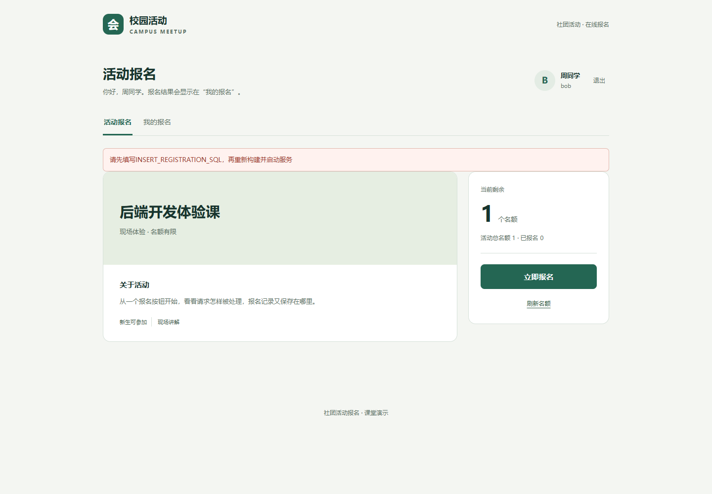

当前练习工程的实际提示：活动已经能查询，点击报名时会提示补写INSERT_REGISTRATION_SQL。

在SignupRepository.java中，将第二个空字符串改为：

```java
private static final String INSERT_REGISTRATION_SQL = "INSERT INTO registrations(event_id, user_id) VALUES (?, ?)";
```

 

这句话向报名表新增一行，需要两个值：报哪场活动、谁来报名。下面的参数绑定代码已经提供，可以在insert方法里找到：

```java
ps.setLong(1, eventId);
ps.setLong(2, userId);
```

 

第一个问号接eventId，第二个问号接userId。用户ID由后端根据登录状态确认；只在网页上改一个数字，不应该就能替别人报名。

**把两个值按顺序绑定到问号**

以活动ID为10、登录用户myh的示例ID为4来理解。

| SQL占位符 | Java参数 | 示例值 |
| --- | --- | --- |
| 第一个问号，对应event_id | eventId | 10 |
| 第二个问号，对应user_id | userId | 4 |

```sql
SELECT * FROM registrations WHERE event_id = ? AND user_id = ?;
```

真实代码按参数位置绑定值，登录身份由后端确认。用户ID请使用自己这次登录响应中的值。

小演示默认展示活动10与myh，选择活动1就能对应当前网页。保存代码后停止旧进程，再Run；服务重启会清掉内存中的登录会话，回到网页重新登录myh，再点击“立即报名”。

### 5. 页面说成功了，再去数据库里确认一下

现在按钮应变成“已报名”。打开“我的报名”，能看到这场活动和报名编号，再回到IDEA的signup_lab Query Console执行：

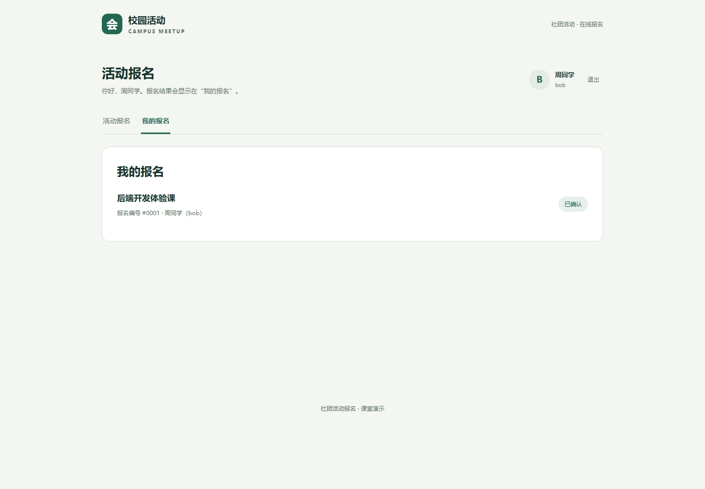

补好两句SQL后的真实后端联调界面：Bob在活动1的报名，已经能从MySQL查回并显示在“我的报名”。

```sql
SELECT id, event_id, user_id, created_at
FROM registrations
WHERE event_id = 1 AND user_id = (SELECT id FROM users WHERE username = 'myh');
```

 

这里查的是myh在活动1中的报名。核对这行记录与网页编号，再刷新页面、重新查看“我的报名”，记录仍然存在。也可以重跑上一节的JOIN查询，把账号和活动名一起查出来。

报名ID由数据库生成，可能跳号，不要求与你看到的示例数字相同。如果活动1已经满员，先查报名表确认原因；需要重新体验时，在自己的signup_lab中执行 `sql/90_重置开场活动.sql`，它会清理活动1的已有报名。

<details>
<summary>新版页面还能注册自己的账号，可以顺手试一下</summary>

先退出当前账号，切换到“注册账号”，填写称呼、账号、密码和确认密码。创建成功后会回到登录页，并带入新账号；再输入密码完成登录。

账号用字母开头的3至32位字母、数字或下划线，保存为小写；新密码8至64个字符，UTF-8编码不超过72字节。演示账号zhh、myh的旧密码demo123仍然可用。

注册会把账号写进MySQL，但不会直接创建登录会话。可以在users表查询id、username、display_name，核对刚创建的账号；不需要查询或展示密码字段。旧库出现ACCOUNT_SCHEMA_UPDATE_REQUIRED时，回到[注册功能升级](#database)补执行03脚本。

新账号有自己的用户ID。为了看清后面新增接口时的参数，接下来的Apifox练习继续统一用myh（用户4）和活动10。

</details>

到这里，网页、Java后端和MySQL已经连起来了。下一节打开Apifox，直接发送登录、报名和查询请求，看看网页按钮背后具体传了什么。

</details>

<a id="java"></a>

## 八、打开前端，先完成一次真实报名

### 1. 让5500网页找到8080后端

VS Code单独打开 `material/项目工程/前后端/fronted`，查看config.js：

```javascript
window.APP_CONFIG = { mode:'api', apiBase:'http://127.0.0.1:8080/api', eventId:1 };
```

 

右键index.html → Open with Live Server，确认地址是 `http://127.0.0.1:5500/`。5500提供网页，8080接收接口请求。完整工程已允许本机5500的前端访问；端口被自动换掉时先处理占用，再恢复5500。

### 2. 登录、报名，看看完整工程已经能做什么

点“填入 myh”，再点“登录”，打开活动1。如果还有名额，点击“立即报名”，再进入“我的报名”核对活动和编号。需要自己注册时，创建成功后回登录页登录即可。

活动1只留一个名额，用过的库可能已满。可以先查看自己的已有报名；需要重做时，由演示者在确认当前数据库后使用重置脚本，清理的影响与SQL说明放在拓展中。不要因为名额已满就反复创建数据库。


完整数据库后端：报名记录已保存，记下当前编号。

### 3. 请求能到后端，我们就可以换个工具来发

能查到刚才的报名记录，就说明网页已经能通过Java后端读写MySQL了。工程中的基础代码和数据库都已准备好，接下来打开Apifox，向这套后端直接发送请求，看看点击登录、报名按钮时，究竟传了哪些参数，又收到了什么结果。

接口练习与网页使用同一个活动1“后端开发体验课”，请求同一套8080后端，操作结果可以在两边核对。登录账号继续用`myh`，密码为`demo123`。后续请求需要的用户ID，从本次登录响应中提取，截图和示例中的`4`仅作参考。

在Apifox报名后，回到网页点击刷新活动或重新加载页面，就能看到更新后的名额和报名。要核对“我的报名”，网页与Apifox使用同一个账号。网页已经报过名时，再用同一账号调用报名接口会返回409（ALREADY_REGISTERED），可以直接查询已有记录；活动被其他账号占满时会返回409（EVENT_FULL）。

- [ ] 我已启动完整前后端，能登录并查看自己的报名

<a id="apifox"></a>

## 九、打开Apifox，看看“报名”到底发了什么

刚才在网页上点一下按钮，数据库里就多了一条报名。页面替我们发出了怎样的请求？如果页面只提示“失败”，又该从哪里找原因？这一节用Apifox直接跟后端打交道，把登录、报名和查询各走一遍。

Apifox可以帮我们填写请求地址、参数和正文，也会展示后端的响应。所谓接口调试，就是发一个请求，再检查返回的状态码和内容是否符合预期。网页还没做好时，也可以先用它验证后端。

### 1. 导入接口，先认准自己的8080

打开Apifox，新建一个API项目，在“项目设置 → 导入数据”中选择OpenAPI/Swagger，导入材料里的 `material/apifox相关/基础接口.openapi.json`。不同版本的入口位置可能略有变化，找到“导入数据”即可。

导入后，左侧应能看到注册、登录、查询活动和报名等接口。上一节的完整后端要继续在IDEA中运行，完整工程无需补SQL。

在右上角进入环境管理，新建“本地练习”环境，服务前置URL填 `http://127.0.0.1:8080`。再添加下面这些环境变量，使用客户端的“本地值”；标明留空的三项，现在不要填入说明文字。

```text
base_url,default,,false,http://127.0.0.1:8080,
event_id,default,,false,1,
username,default,,false,myh,
password,default,,false,demo123,
token,default,,false,,
user_id,default,,false,,
registration_id,default,,false,,
```


使用环境变量的“批量编辑”时，复制上方CSV内容。每行依次填写变量名、类型、远程值、跟随远程值、本地值和说明，字段用英文逗号分隔。本示例将值填入本地值列；token、user_id和registration_id先保持空白，后续由接口响应提取。确认后检查变量名只包含base_url、event_id等名称，再保存环境。

环境变量就像给常用值起了名字：后面写 `{{event_id}}`，Apifox会在发送时换成1。改一次环境，就能让多条请求一起使用新的值。[变量与本地值的说明](https://docs.apifox.com/global-environment-session-variables)

选中刚建好的环境，再打开一条接口。导入的地址通常只显示 `/api/...`，前面的主机由环境补上；下面写出的URL是最终地址的表示方式，不用把整段主机重复粘进相对路径。发送前看一下最终请求地址，确认指向8080，而不是Mock服务。

这里换用活动1“接口练习场”，容量为1。上一节网页用的是活动1，后面的接口练习统一用myh和活动1，方便核对参数。

### 2. 先登录，拿到后续请求要带的token

在左侧打开登录接口，方法应为POST，最终地址为 `{{base_url}}/api/auth/login`。在Body中选择JSON，填入：

```json
{"username":"{{username}}","password":"{{password}}"}
```

 

点击“发送”。如果返回200，展开响应正文，找到token和user。记下myh这次登录返回的 `user.id`，后面用它核对报名归属；密码不对时，先改对再继续。

<details>
<summary>登录成功后，这几个字段分别是什么？</summary>

下面是响应的结构示例。token要用自己刚收到的真实值：

```json
{
 "token": "这里应使用本次真实返回的token",
 "user": {"id":4,"username":"myh","displayName":"myh"},
 "expiresInSeconds": 7200
}
```

 

user告诉我们当前是谁，token供后续请求证明登录身份，expiresInSeconds表示这次会话的有效秒数。本项目的登录会话保存在Java进程内存里，重启后端后需要重新登录；MySQL中的账号和报名仍然保留。

</details>

先手动复制一次token。打开查询活动接口，把路径参数eventId的值设为1，在Auth中选择Bearer Token，粘贴刚才的token，再发送GET `/api/events/1`。能看到活动名称、容量和剩余名额，就说明这次请求带上了登录身份。

Bearer Token输入框里只填token本身，Apifox会帮你组成 `Authorization: Bearer 真实token`。以后遇到401，可以先检查是否漏带token，或者后端是否刚刚重启。

导入后如果Auth显示“继承”，输入框中是红色的`{{bearerToken}}`，先将它替换为本次登录响应中的完整token。配置好登录后提取变量后，再填写`{{token}}`，与环境变量名称保持一致。用户ID是登录响应中的user.id，不能填入Authorization Token。

### 3. 每次都复制token太麻烦？让后置操作来填

token每次登录都会变化。我们可以让Apifox在收到登录响应后，自动取出它，再交给下一条请求使用。

1. 回到登录请求，打开“后置操作 / Post Processors”，添加“提取变量”。

2. 来源选择响应JSON，变量类型选择环境变量，变量名填token，JSONPath表达式填 `$.token`。

3. 再添加一项：变量名user_id，表达式 `$.user.id`，同样保存为环境变量。

4. 重新发送登录请求，到当前环境中查看本地值，确认两项都有了实际内容。

5. 回到查询活动请求，将Bearer Token的值改成 `{{token}}`，路径参数eventId改为 `{{event_id}}`，再发送一次。

这里的 `$`代表整份响应，`$.user.id`就是取user里面的id。配置好以后，重新登录会更新token，后续请求会引用新值。[后置提取的官方操作说明](https://docs.apifox.com/doc-5580967)

<details>
<summary>想用现成脚本，也可以这样设置</summary>

在登录请求的“后置操作 → 添加后置操作 → 自定义脚本”中，粘贴[01_登录.js](apifox%E7%9B%B8%E5%85%B3/Apifox%E5%90%8E%E7%BD%AE%E8%84%9A%E6%9C%AC/01_%E7%99%BB%E5%BD%95.js)。它会检查200、保存身份；登录失败时清理旧值，切换账号时清掉上一人的报名ID。

选用脚本后，删掉同一请求里重复设置这些变量的可视化提取项，避免两套操作同时修改变量。[后置脚本入口](https://docs.apifox.com/post-request-scripts)

</details>

- [ ] 我能登录，并让后续请求自动使用新token

### 4. 查清楚活动，再发出报名请求

刚才的查询最终应指向 `{{base_url}}/api/events/{{event_id}}`。导入接口中，路径参数叫eventId，值填 `{{event_id}}`；它会替换URL里的那一段，不用在Query参数中再加一个eventId。

| 填写位置 | 这次放什么 | 它有什么用 |
| --- | --- | --- |
| 方法与路径 | GET查活动，POST提交报名 | 告诉后端要做哪件事 |
| 路径参数 | eventId = {{event_id}} | 指定要操作的活动 |
| Auth | Bearer Token = {{token}} | 让后端确认当前账号 |
| Body | 报名时选择JSON，填 {} | 按接口约定提交请求正文 |

确认查到的是活动1、总容量为1，还有剩余名额，再打开报名接口发送：

```http
POST {{base_url}}/api/events/{{event_id}}/registrations
Authorization: Bearer {{token}}
Content-Type: application/json
{}
```

 

Body要选择JSON并填写空对象 `{}`。这个接口根据token确认报名者，所以正文不用再填userId。

myh第一次报名应返回201，正文包含id、eventId和userId。已经报过则会返回409与ALREADY_REGISTERED；如果需要从头体验，在自己的signup_demo中执行 `sql/90_重置开场活动.sql`，再重新发送。这个脚本会清理活动1的已有报名，执行前先确认当前库。

### 5. 拿着报名ID，把刚才那条记录查回来

找到报名响应中的id，先手动填进GET `/api/registrations/实际id`，带上同一个token发送，核对是否查回了原记录。

手动查通后，再给报名请求添加后置提取：来源为响应JSON，表达式 `$.id`，保存到环境变量registration_id。这个值应来自201成功响应。重新演练首次报名并取得ID后，把查询请求改为：

```http
GET {{base_url}}/api/registrations/{{registration_id}}
Authorization: Bearer {{token}}
```

 

导入后的路径参数名是registrationId，值填 `{{registration_id}}`。响应中的id应与报名时相同，eventId为1、userId与登录返回的user_id一致。

<details>
<summary>报名返回409，为什么不能继续提取id？</summary>

失败响应里没有有效报名ID，不要把它当作报名成功继续往下走。可以改用[02_报名.js](apifox%E7%9B%B8%E5%85%B3/Apifox%E5%90%8E%E7%BD%AE%E8%84%9A%E6%9C%AC/02_%E6%8A%A5%E5%90%8D.js)，放在报名请求的后置自定义脚本中，并移除重复的可视化ID提取项。它只在201时保存ID、检查账号和活动，失败时保留原来的ID。

这个脚本将“首次报名”断言为201。重复报名另存一个用例，预期409与ALREADY_REGISTERED；出现这个结果时，首次成功用例中的201断言失败是正常的。

同一个账号重新登录，可以继续查自己的原报名。换账号时，要清掉旧报名ID；登录后置脚本已经处理了这一步。

</details>

**变量在请求之间怎样传递**

| 请求 | 从响应中取出 | 后续用途 |
| --- | --- | --- |
| 登录 | token、user.id | token用于认证，user_id用于核对报名归属 |
| 报名 | id | 保存为registration_id |
| 查询报名 | 原报名的id、eventId、userId | 核对查回的是同一账号的同一条报名 |

在Apifox中依次完成这三条请求，观察环境变量的本地值怎样更新。

### 6. 对照响应，再试一次重复报名

先核对报名响应与按ID查询的响应：id相同，eventId为1，userId与本次登录提取的user_id一致。再原样发送一次报名，应返回409与ALREADY_REGISTERED；已有的报名仍可查询。

<details>
<summary>拓展：想从MySQL再核对一次？</summary>

回到IDEA的signup_demo Query Console，把下面的57换成刚才实际取得的报名ID，再执行：

```sql
SELECT id, event_id, user_id, created_at
FROM registrations WHERE id = 57;
```

 

核对id与接口响应一致，event_id是10，user_id对应myh本次登录的用户ID。现在原样再发一次报名请求，应得到409与ALREADY_REGISTERED，数据库不会因此多出一行。

</details>

<details>
<summary>想再试一个接口？用Apifox注册自己的账号</summary>

打开已导入的POST `/api/auth/register`，不需要Bearer Token。在Body中选择JSON，填写下面的示例；charlie已经用过的话，换一个新账号名。

```json
{"username":"charlie","displayName":"陈同学","password":"classroom123"}
```

 

首次创建返回201与账号信息，不包含token；同名账号返回409与USERNAME_TAKEN。注册后仍需调用登录接口，规则与前面的网页相同。若旧库提示ACCOUNT_SCHEMA_UPDATE_REQUIRED，回到[数据库准备](#database)检查03升级脚本。

试完后把登录环境变量恢复成myh、demo123，重新发送登录请求，确认user_id与本次登录返回一致。下一节还要用这条报名来找一个参数错误。

</details>

- [ ] 我完成了登录、报名、按ID查询，并在IDEA里找到了同一条记录

<a id="new-api"></a>

## 十、给完整工程加个新接口，再修一个“查不到”的错误

刚才查报名，需要先知道报名ID。如果只知道自己参加了哪场活动，能不能直接查到报名？接下来添加GET `/api/events/{eventId}/registration-status`，让新入口按活动和当前登录者查找。原有my-registration路径仍可使用，这次的路径不与它重复。

完整工程已有my-registration入口，这次另加registration-status入口，材料里准备了带一个参数错误的控制器。我们把它接进工程，看看怎样从一次失败请求找到问题。完整工程里的原接口保留，课堂文件只在复制成.java后才会参与编译。

### 1. 先留下参照：myh确实报了活动1

在Apifox确认event_id仍为1，user_id来自myh本次登录响应。使用同一token，让上一节的按报名ID查询返回200。记下这次成功响应中的报名ID。后面用同一账号和活动比较新旧接口；若已有接口都查不到，先完成上一节的报名。

<details>
<summary>拓展：也可以在IDEA核对数据库记录</summary>

```sql
SELECT r.* FROM registrations r JOIN users u ON u.id=r.user_id
WHERE r.event_id=1 AND u.username='myh';
```

</details>

### 2. 把新入口加进IDEA工程

1. 在项目树找到 `课堂文件/RegistrationStatusController.错误.java.txt`，复制到 `src/main/java/cn/meeting/signup/`。

2. 右键副本，选择Refactor → Rename，将文件名改为 `RegistrationStatusController.java`，确认末尾没有.txt。

3. 打开文件，看一眼 `@GetMapping` 后面的路径。它告诉Spring MVC：收到这个路径的GET请求时，调用下面的方法。

4. 保存，在IDEA停止旧后端，再Run同一配置。服务重启后，到Apifox重新发送登录请求，更新token。

原报名保存在MySQL里，重启后不需要再报一次。接着在Apifox新建一个GET接口，保存为“查询我在这场活动中的报名”，地址和认证填写：

```http
GET {{base_url}}/api/events/{{event_id}}/registration-status
Authorization: Bearer {{token}}
```

 

如果在接口设计页使用 `/api/events/{eventId}/registration-status`，就把路径参数eventId的值设为 `{{event_id}}`，Bearer Token填 `{{token}}`。最终地址应是自己8080服务下的 `/api/events/1/registration-status`。

点击发送，预期收到404与REGISTRATION_NOT_FOUND。同一账号、同一场活动，旧接口能查到，新接口却查不到，先从两条请求传给后端的值找起。

### 3. 给Java打个断点，看清这两个ID

打开刚添加的RegistrationStatusController.java，找到下面两行：

```java
long userId = auth.require(request).id();
return service.myRegistration(eventId, eventId);
```

 

第一行根据登录身份取出用户ID。第二行调用已有的查询方法，两个参数依次是“活动ID”和“用户ID”。现在却传了两遍eventId。

在return行左侧的行号旁点击，出现红点就是加好了断点。停止当前Run进程，用IDEA的Debug按钮启动；重新登录，再发送刚才的GET请求。Apifox暂时等待时，切回IDEA：程序应停在断点处。

在Debug窗口的Variables里查看eventId和userId，也可以把鼠标悬停在变量上。新库示例分别为1和4，已有库的userId以登录响应为准；方法调用却把1传了两次。点击Resume Program（常用快捷键F9）让它继续，Apifox才会收到响应。

**观察第二个参数对查询的影响**

以下固定样例中，myh的用户ID为4，报名活动ID为10。

| 方法调用 | 查询条件 | 样例结果 |
| --- | --- | --- |
| `myRegistration(eventId, eventId)` | `event_id = 10 AND user_id = 10` | 404，`REGISTRATION_NOT_FOUND` |
| `myRegistration(eventId, userId)` | `event_id = 10 AND user_id = 4` | 200，查回自己的报名 |

在工程中修正第二个参数，构建并重启后端，重新登录，再发送同一条请求验证。

如果一直等不到响应，先看看IDEA是不是还停在红点处。观察结束后，再点击左侧红点取消断点。

<details>
<summary>核对答案：第二个参数应该传什么？</summary>

把第二个参数改成当前登录者的userId：

```java
return service.myRegistration(eventId, userId);
```

 

错误版本查的是“活动1、用户1”，示例记录却属于“活动1、用户4”（已有库按实际用户ID核对）。这里特意使用不同的活动ID和用户ID，错误才不会碰巧被相同的数字掩盖。

</details>

### 4. 改完再发同一个请求，核对返回的确实是自己

保存修改，停止旧进程，再Run或Debug。重新登录更新token，然后发送同一条GET：这次应返回200，eventId为1、userId与登录返回的user_id一致，id与前面记下的报名ID一致。

再把登录变量换成zhh、demo123，重新登录并发送新接口。如果zhh没有报名活动1，应返回404与REGISTRATION_NOT_FOUND。试完后恢复myh并重新登录，给下一节脚本练习保留相同的账号条件。

遇到404时，可以结合响应中的code判断从哪里查起：

| 返回内容 | 先检查哪里 |
| --- | --- |
| NOT_FOUND | 请求方法、路径、新类是否被编译并加载 |
| REGISTRATION_NOT_FOUND | 当前账号、活动ID，以及传给查询方法的参数 |
| EVENT_NOT_FOUND | 请求中的活动ID，在当前数据库里是否存在 |

- [ ] 我添加并修正了新接口，能查回当前账号的同一条报名

<a id="extend"></a>

## 十一、把检查交给脚本，再聊聊AI怎样参与开发

修完一个参数后，我们又登录、又查询，还核对了一遍报名ID。以后每改一次代码都点这些请求，很容易漏掉某一步。可以先把固定的检查写成脚本，让电脑替我们重复执行。

### 1. 运行一次自动检查，看看它会做什么

先确认完整后端在8080运行，完整工程已连通数据库，上一节的新接口也已修正。若刚用Debug观察过参数，先取消断点，或改用Run启动，避免脚本请求停在那里。

打开IDEA底部的Terminal，使用PowerShell，进入包含“项目”“资料”两个文件夹的材料根目录。把第一行替换成自己的实际路径，再运行：

```powershell
cd "D:\signup-class"
powershell -NoProfile -ExecutionPolicy Bypass -File .\资料\自动检查.ps1 -BaseUrl http://127.0.0.1:8080 -CheckAddedEndpoint
```

 

脚本默认请求完整后端8080。CheckAddedEndpoint会额外检查本节新增的registration-status入口，需先完成上一节的修错。它使用myh和活动1，会实际发出报名请求、读写当前练习数据库。ExecutionPolicy Bypass只用于这次启动的PowerShell进程，不需要改全局执行策略。

打开 `material/apifox相关/自动检查.ps1`，可以对照刚才的手动操作读一遍：

| 脚本做到哪一步 | 它在确认什么 |
| --- | --- |
| 登录、查询活动 | 取得token，活动ID与本次目标相同 |
| 提交报名 | 首次创建报名；已经报过则查询原记录 |
| 核对报名归属 | 返回的userId和eventId与当前账号、活动一致 |
| 按ID查询，再调用新接口 | 原有查询与新增入口都指向同一条报名 |

运行中会逐项输出PASS，最后看到 `All checks passed.`，说明这些检查都通过了。再运行一次，myh已经报名，脚本会处理409 ALREADY_REGISTERED并核对已有记录，不会把重复报名当作新增成功。

如果中途出现红色错误，先找最后通过了哪一步。401检查登录状态，404检查新接口和参数，EVENT_FULL说明活动名额已满；需要重置时，回到[接口报名练习](#apifox)确认数据库再执行91脚本。改完代码、重新运行后端，再重跑检查。

### 2. 脚本全绿了，是不是就可以放心了？

这个脚本检查了一条固定账号、固定活动的请求流程，还没有覆盖两个账号同时抢名额、网页显示和所有异常输入。它能帮我们反复核对已有行为，新的业务规则还需要补上对应检查。

比如开场的“只剩一个名额”，就需要让两个账号同时提交，确认恰好一个成功，再查MySQL只新增了一行。只看某一次请求返回200或201，回答不了这个问题。

### 3. 如果让AI来做这个项目，先告诉它什么？

只说“帮我做一个报名系统”，还留着不少问题：需要登录吗？同一个人能报几次？名额满了返回什么？这些如果没约定，AI写出的系统可能能运行，行为却和我们想的不同。

可以先写一小段大家都能核对的需求：

> 活动有固定名额，用户登录后才能报名，每个账号每场只能报名一次。成功报名保存到MySQL，关掉网页重新登录仍能查到。用户只能查询自己的报名。

再把“怎样算做对”写具体：

| 要验证的行为 | 本项目的验收方式 |
| --- | --- |
| 最后一个名额不会超卖 | 两个账号同时提交，恰好一人成功，MySQL只新增一行 |
| 报名保存下来 | 重新登录后查回同一条报名 |
| 同一个人不能重复报 | 再次报名返回409与ALREADY_REGISTERED |
| 名额满后不能继续报 | 未报名账号提交，返回409与EVENT_FULL |
| 不能查询别人的报名 | 用另一账号的token按报名ID查询，返回404 |

### 4. 认识SDD：把这些约定贯穿到开发中

SDD是Spec-Driven Development，通常译作“规格驱动开发”。这里的规格，就是把要实现的行为、边界和验收条件写清楚，后续设计、代码与检查都围绕它展开。需求变了，也要更新这些约定。

放到今天的项目里，可以这样走：先确认报名规则，规划Java、Spring Boot和MySQL怎样配合，再拆成建表、登录、报名和查询等任务，最后用Apifox、SQL与脚本检查实际结果。AI可以协助整理规格、拆任务、生成代码和检查脚本；人来确认业务规则，审查实现并验收。

[GitHub Spec Kit](https://github.com/github/spec-kit)是可以继续了解的开源工具，它用规格、计划、任务来组织实现工作。先看它怎样安排这些步骤即可，不需要在这里再安装一套环境。项目里的SDD示例也把今天的报名需求整理成了一页，可以拿它试着向AI描述一次任务。

- [ ] 选做：我运行了自动检查，也能把报名规则写成可核对的验收条件

<a id="environment"></a>

## 环境配置教程：把工具装好，跟着步骤检查一遍

下面按Windows 10/11的x64电脑介绍配置步骤。开始前，先到“设置 → 系统 → 系统信息/关于”看一眼系统类型。ARM电脑、macOS或Linux需要选择对应的安装包，服务管理方式也有所不同。已经装好的工具先检查，版本符合要求就可以继续用。

下面配有官方下载页和软件界面的截图，来源放在图下。图中的用户名、目录和版本号是示例，填写时以自己的电脑为准。看不清时可点击图片查看原图。每节末尾的“回到准备清单”可以跳回本页开头。

<a id="prep-files"></a>

### 01 先放好材料，认一认几个端口

1. 先把完整的材料文件夹放到自己能读写的位置，例如 `D:\signup-class`。没有D盘就用 `C:\dev\signup-class`，后文的路径也跟着替换。除了网页，`项目/`、`material/apifox相关/`和`课堂文件/`也要一起保留。

2. 打开资源管理器，选择“查看 → 显示 → 文件扩展名”（Win10在“查看”选项卡勾选）。确认能看见 `.java`、`.sql`、`.json`、`.txt`。后面复制Controller文件时，要去掉末尾的 `.txt`。

3. 浏览器用Edge或Chrome即可。需要同时操作两个账号时，可以分别打开两个浏览器，或使用普通窗口和无痕窗口，避免共用登录状态。访问本机页面不需要登录浏览器账号。

4. 这次会用到下面几个端口，可以先留着这张表方便查。MySQL的3306用于数据库连接，在浏览器中输入它不会打开数据库管理页。

| 服务 | 本课默认值 | 在哪里修改 |
| --- | --- | --- |
| MySQL服务 | 3306 | Configurator；改动后同步IDEA数据源与DB_PORT |
| 完整后端 | 8080 | IDEA运行配置SERVER_PORT |
| SQL填空拓展后端 | 8081 | IDEA运行配置SERVER_PORT |
| 内存演示后端 | 8082 | IDEA运行配置SERVER_PORT |
| VS Code联调前端 | 5500 | 前端联调版/.vscode/settings.json |
| VS Code纯前端 | 5501 | 纯前端版/.vscode/settings.json |

工程已经配置好允许本机5500前端访问后端。如果Live Server因端口占用自动换了号码，先检查自己启动的服务，处理冲突后恢复5500，再继续联调。排查时保留不认识的进程，避免影响其他程序。

[回到准备清单](#before)

<a id="prep-jdk"></a>

### 02 安装JDK 21，并核对环境变量

#### 下载前，先确认版本和安装包类型

打开[Temurin官方下载页](https://adoptium.net/temurin/releases/?version=21&os=windows&arch=x64&package=jdk)，依次确认版本21 LTS、操作系统Windows、架构x64，下载 **JDK的.msi安装包**。这次需要JDK中提供的编译器，单独安装JRE还不够。下载页的补丁号可能变化，确认大版本为21即可。

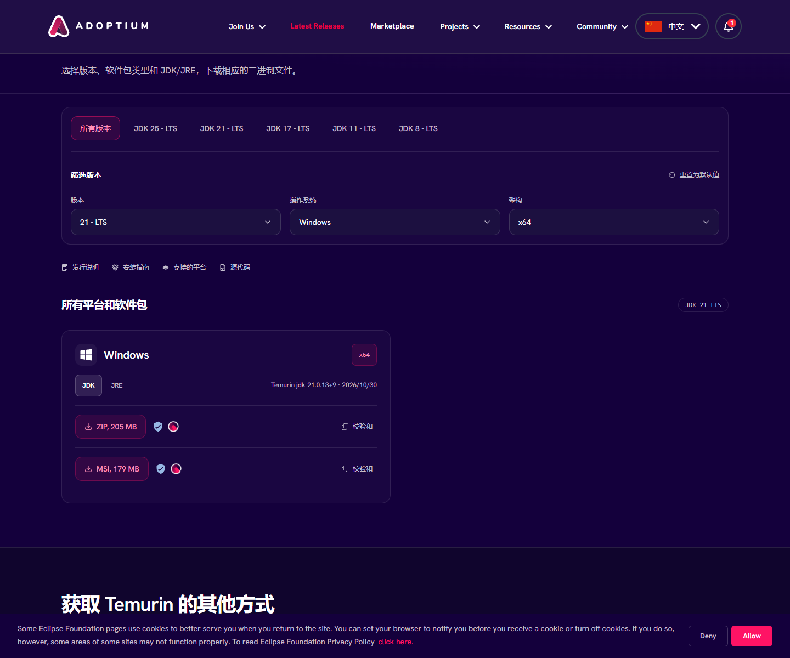

JDK21官方下载页；确认21 LTS、Windows、x64和JDK，选择MSI。 [官方下载页实拍](https://adoptium.net/temurin/releases/?version=21&os=windows&arch=x64&package=jdk)

#### 安装与初次设置

运行MSI，接受许可，安装到默认目录即可。在Custom Setup页展开功能列表，确认“Add to PATH”启用；把“Set JAVA_HOME variable”设为安装到本地硬盘。不同版本措辞略有差别，含义分别是“让终端找到Java”和“告诉工具JDK装在哪里”。随后Next → Install → Finish。

安装器通常可以完成下面的设置，接下来检查一遍即可，已有的项目不用重复添加。按Win键搜索“编辑系统环境变量”，打开后点“环境变量”。检查 `JAVA_HOME` 的值是否为实际的JDK21根目录，例如 `C:\Program Files\Eclipse Adoptium\jdk-21.…-hotspot`，填写时用自己的完整目录，停在JDK根目录这一层，不包含bin。再编辑同一范围的 `Path`，确认有 `%JAVA_HOME%\bin` 或指向同一JDK21的bin目录。

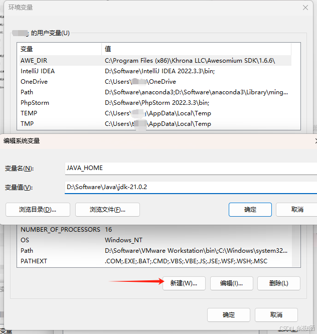

Windows环境变量实际界面；图中D盘目录是作者示例，请换成自己的JDK21根目录。 [CSDN原教程截图](https://blog.csdn.net/tg928600774/article/details/142770912)

填写示意 · 请使用自己电脑上的真实目录

**JAVA_HOME** C:\Program Files\Eclipse Adoptium\jdk-21.…-hotspot

**Path的一行** %JAVA_HOME%\bin

保留Path中的其他行。此处是配置示意，不是系统截图。

电脑原来装过Java的话，检查旧路径是否排在JDK21前面。修改系统变量需要管理员权限，只为当前Windows账号配置时也可以使用用户变量；设置后都要用下面的命令确认实际调用的是哪个Java。保留Path中的其他项目，逐个窗口点确定保存，再重新打开PowerShell、IDEA与VS Code，让新设置生效。这里不用额外设置CLASSPATH。

#### 重新打开PowerShell，检查是否配好了

按Win键搜索PowerShell，打开普通窗口，逐行执行：

```powershell
java -version
javac -version
$env:JAVA_HOME
Get-Command java -All | Select-Object Source
Test-Path "$env:JAVA_HOME\bin\javac.exe"
```

 

先看结果：前两项应显示21，最后一项应为True。`JAVA_HOME`指向安装目录，Get-Command显示实际运行的java.exe位置。如果仍然显示Java 8/17，就根据输出找到旧路径，调整Path中的先后顺序，再开一个终端检查。IDEA自带的运行时负责启动编辑器，工程使用的JDK21还需要单独选择。

本工程之前也验证过JDK25，但新安装统一使用21。来源：[Adoptium的MSI安装说明](https://adoptium.net/installation/windows/)、[Microsoft的Windows Java环境配置](https://learn.microsoft.com/en-us/windows/dev-environment/java)。

[回到准备清单](#before)

<a id="prep-idea"></a>

### 03 安装IDEA，完成项目与Maven设置

#### 下载桌面版IDEA，检查数据库功能

到[IntelliJ IDEA官方下载页](https://www.jetbrains.com/idea/download/?section=windows)，选择Windows桌面安装包 `.exe`。这页也可能展示VS Code/Cursor扩展，本课使用的是独立的IntelliJ IDEA。2025.3起官方合并为统一产品，旧教程里的Community/Ultimate双下载入口不一定还存在。[版本与授权说明](https://www.jetbrains.com/help/idea/installation-guide.html)

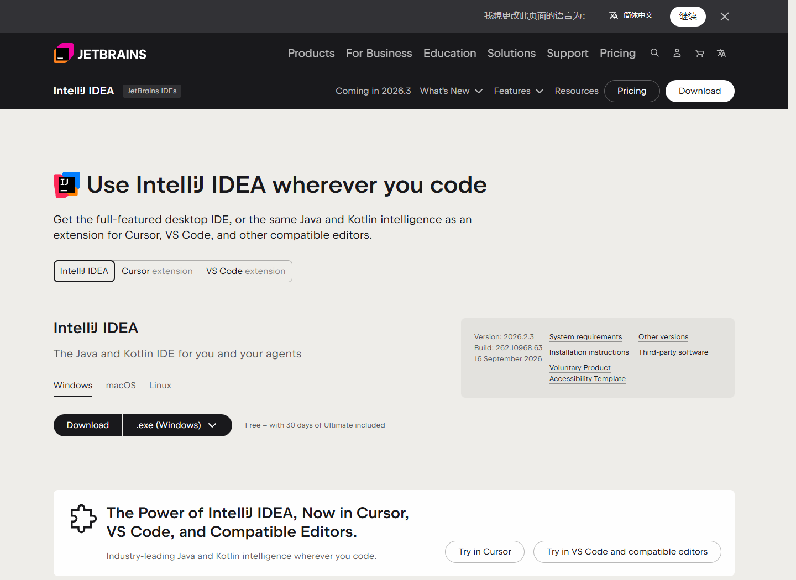

IDEA官方下载页；选择Windows桌面.exe，而非编辑器扩展。 [官方下载页实拍](https://www.jetbrains.com/idea/download/?section=windows)

核心Java功能可免费使用，Database Tools and SQL的支持范围受授权限制。想做IDEA数据库拓展时，再确认可用的Ultimate试用或已有教育授权；符合条件时可从[JetBrains教育授权申请页](https://www.jetbrains.com/academy/student-pack/)申请。**主线只需Java运行与调试；选择数据库拓展时，再完成Test Connection和SELECT。** 不同账号、版本和试用状态以软件实际提示为准。

#### 安装与首次启动

1. 运行安装包，按向导选择安装目录。在Installation Options页，可勾选桌面快捷方式、Add “Open Folder as Project”和添加启动器到PATH；`.java`关联按个人习惯选择。这些选项方便打开文件，工程所需的JDK仍按上一节安装。

2. 完成安装，首次启动时接受许可，按提示选择是否导入旧设置。首次使用可选择不导入；主题和字体按个人习惯即可。

3. 按 `Ctrl+Alt+S` 打开Settings。搜索Plugins → Installed，确认Java和Maven启用；Database Tools and SQL用于可选数据库拓展。刚启用插件时，按提示重启IDEA。使用中文界面也没关系，在设置搜索框输入对应英文名称即可。

4. Settings → Editor → File Encodings，把Global Encoding与Project Encoding设为UTF-8，避免Java、SQL中的中文出现乱码。插件先装本次要用到的即可。

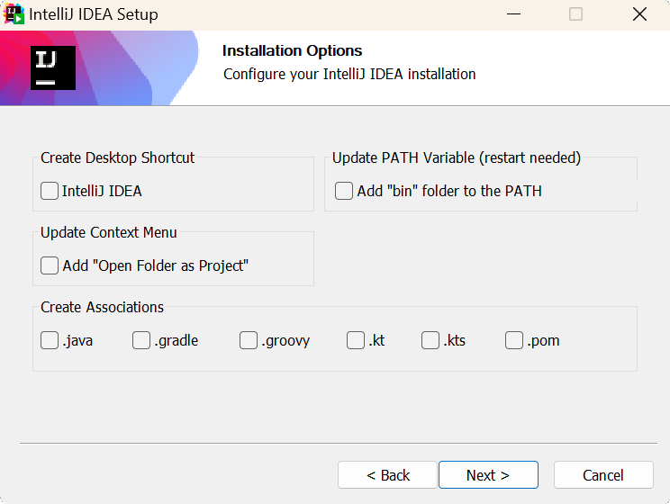

Windows安装选项；快捷方式、PATH与文件关联可在这里选择。 [JetBrains官方界面图](https://www.jetbrains.com/help/idea/installation-guide.html)

#### 打开现成的完整工程

在欢迎页点Open，选 `material/项目工程/前后端/backend/pom.xml`，有选择时点Open as Project；也可打开完整工程文件夹，再把pom.xml作为Maven项目加载。确认工程来源后再信任并打开。等IDEA完成同步，左边应能展开src和pom.xml，右侧能打开Maven工具窗口。这里使用现成工程，直接Open即可，不需要通过New Project另建空项目。

按 `Ctrl+Alt+Shift+S` 打开Project Structure → Project，SDK选21。列表里没有就点Add SDK → JDK/Add JDK from Disk，定位到前面安装的JDK根目录。Modules → Dependencies里的Module SDK选Project SDK。Language level沿用项目默认值或21，不选择预览特性。

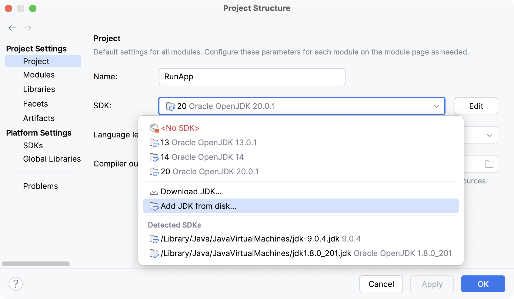

Project Structure中的SDK入口；图为macOS外观与其他JDK版本，Windows入口相同，本课选21与自己的安装目录。 [JetBrains官方界面图](https://www.jetbrains.com/help/idea/sdk.html)

截图中的SDK版本是官方示例；本课填21，目录选你自己的JDK。来源：[SDK设置](https://www.jetbrains.com/help/idea/sdk.html)。

#### 配好Maven，等依赖下载完成

在Settings → Build, Execution, Deployment → Build Tools → Maven中：Maven home path用Bundled Maven/Maven 3；如果IDEA自动识别了工程的Wrapper，也可保留Wrapper。第一次同步需要联网，Maven会下载工程依赖。使用内置Maven或Wrapper即可，不用另外安装全局Maven，也不用手动下载Spring Boot与MySQL驱动JAR。

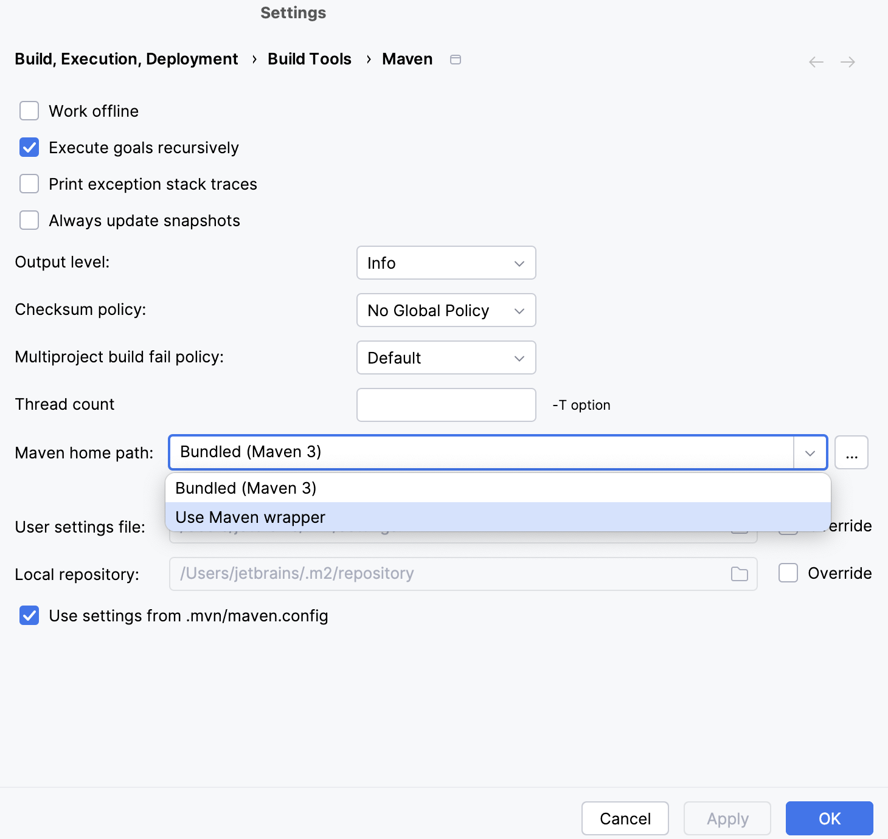

Maven home path入口；使用IDEA内置Maven或工程Wrapper。 [JetBrains官方界面图](https://www.jetbrains.com/help/idea/maven-support.html)

展开Importing，把JDK for importer选Project SDK/JDK21；展开Runner，把JRE选Project JDK/JDK21。部分版本Importer的选项位置或名称不同，用设置搜索即可。Maven面板取消Offline Mode，再点Reload All Maven Projects，等进度结束。[Maven设置说明](https://www.jetbrains.com/help/idea/maven-support.html)、[Importer选项](https://www.jetbrains.com/help/idea/maven-importing.html)

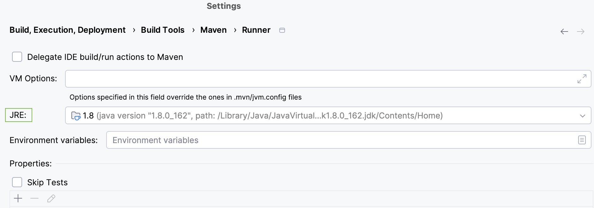

Maven Runner的JRE设置；本课选择Project JDK或JDK21。 [JetBrains官方界面图](https://www.jetbrains.com/help/idea/maven-support.html)

**完成标志：** pom.xml被识别为Maven项目，依赖同步没有下载错误；Project SDK与Maven Runner都指向21。完整工程中的代码已提供，先完成依赖同步即可。

如果出现Cannot resolve或Could not transfer artifact，先在Maven同步日志里找到报错的域名，检查网络和离线模式，再点Reload。沿用工程原有配置即可，排查时保留证书验证，镜像配置也先确认来源再使用。命令行备用构建使用工程自带的 `mvnw.cmd`，不以系统 `mvn` 是否存在判断环境是否合格。

[回到准备清单](#before)

<a id="prep-mysql"></a>

### 04 安装MySQL 8.4，并让服务正常运行

#### 已经装过MySQL？先检查现有服务

在开始菜单搜索“服务”，看看电脑上是否已有MySQL。现有8.0/8.4能正常使用，就记下服务名、端口和管理员密码继续用，不必为了与截图一致而重装或升级。第一次安装的话，按下面的8.4流程操作。

打开[MySQL Community Server 8.4下载页](https://dev.mysql.com/downloads/mysql/8.4.html)，版本选8.4 LTS，系统选Microsoft Windows，选 **Windows (x86, 64-bit), MSI Installer**。这里要安装的是数据库服务，下载时留意不要选成调试包或仅含工具的包；Workbench是管理工具，不能代替数据库服务。下载确认页如果要求Oracle登录，可选择“No thanks, just start my download”。[安装包说明](https://dev.mysql.com/doc/refman/8.4/en/windows-choosing-package.html)

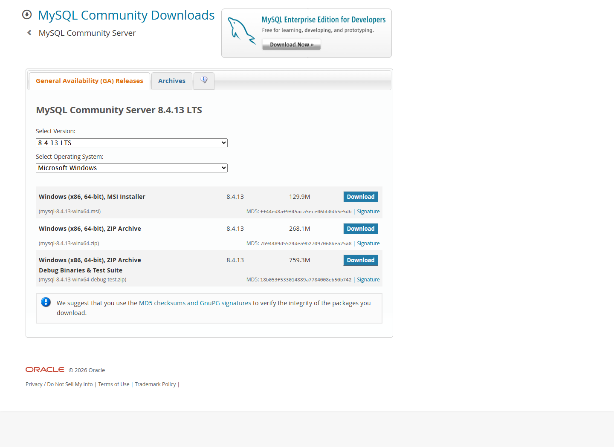

MySQL官方8.4下载页；选择Windows MSI Installer，补丁号可与图片不同。 [官方下载页实拍](https://dev.mysql.com/downloads/mysql/8.4.html)

若安装器提示缺少Visual C++运行库，去[Microsoft官方下载页](https://learn.microsoft.com/en-us/cpp/windows/latest-supported-vc-redist?view=msvc-170)选择x64的v14 Redistributable，安装或修复完成后再运行MySQL安装器。已有运行库的电脑不用重复安装；这是运行库，不用下载整套Visual Studio。

#### 接着用Configurator完成服务配置

运行MSI，接受许可，保留适合本机的默认安装目录，完成安装。最后勾选Run MySQL Configurator，点Finish。如果先关掉了窗口，从开始菜单打开MySQL Configurator。**安装程序文件后，还需要完成服务配置，MySQL才能正常运行。** [Windows安装说明](https://dev.mysql.com/doc/refman/8.4/en/windows-installation.html)

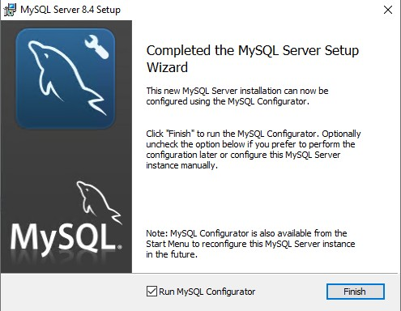

MySQL8.4安装完成页；勾选Run MySQL Configurator后继续完成服务配置。 [Oracle官方界面图，仅引用安装完成页](https://docs.oracle.com/en/industries/hospitality/token-proxy/19.3/tpsig/t_windows_upgrade_process.htm)

首次安装时按下表填写。如果配置器检测到已有实例，或出现升级选项，先确认旧实例的用途，再决定如何处理，保留原有数据库。

| 页面 | 本课怎么选 |
| --- | --- |
| Data Directory（若出现） | 新安装沿用推荐目录；不选择其他旧实例的数据目录 |
| Type and Networking | Development Computer；启用TCP/IP，端口3306；本课只连本机，可取消为外部网络开放防火墙端口 |
| Accounts and Roles | 给root设置并记下密码，重复输入确认；root是数据库管理员，不是网页zhh/myh账号 |
| Windows Service | 勾选Configure MySQL Server as a Windows Service；记下实际服务名，例如MySQL84；可勾选开机启动；服务账户保留Standard System Account |
| File Permissions | 使用配置器推荐权限，继续下一步 |
| Sample Databases | 本课不使用示例库，可以不选；稍后会导入报名系统的SQL |
| Apply Configuration | 点击Execute，等待各步骤完成，再Finish；有红叉先展开日志定位原因 |

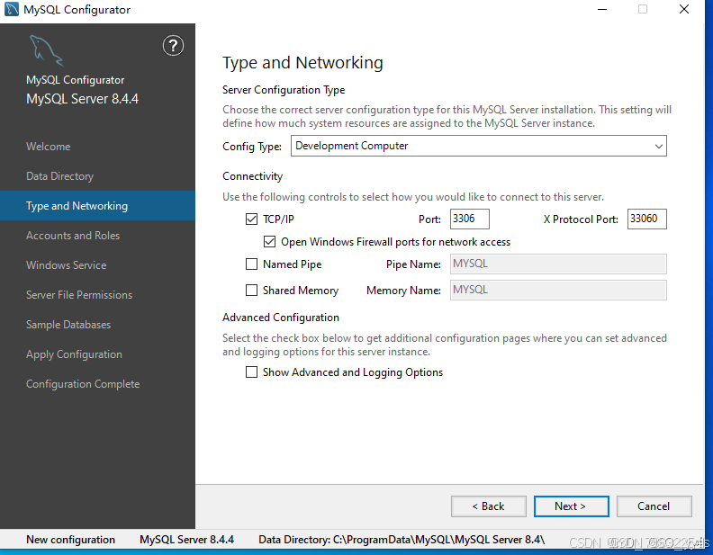

MySQL8.4.4的网络配置界面；开发电脑、TCP/IP与3306。本课仅连本机，可取消图中开放外部防火墙端口的勾选。 [CSDN原教程截图](https://blog.csdn.net/SQ_yyds/article/details/146160635)

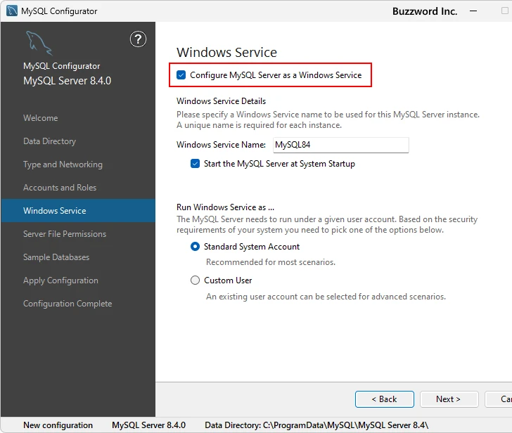

MySQL8.4的Windows Service配置；登记服务名并选择系统账户，实际服务名以本机为准。 [DBOnline原教程截图](https://www.dbonline.jp/mysql/install/index4.html)

配置字段以[MySQL 8.4 Configurator手册](https://dev.mysql.com/doc/refman/8.4/en/mysql-configurator-workflow-server.html)为准。截图中的8.4补丁号和目录可与本机不同；本课不用Named Pipe、Shared Memory或额外的高级日志设置。

#### 配好以后，怎样启动MySQL？

按 `Win+R`，输入 `services.msc`，回车。在列表找到自己的MySQL服务，状态应为“正在运行/Running”。没运行就右键 → 启动。也可以从IDEA Terminal或PowerShell查看；启动服务通常需要管理员权限：

```powershell
Get-Service -Name '*MySQL*'
```

 

查到的服务名是MySQL84时，就在管理员PowerShell中执行下面这一行；名称不同时换成自己的实际服务名，MySQL80、MySQL84都只是可能的名称。

```powershell
Start-Service -Name 'MySQL84'
```

 

再查看Get-Service，确认Running；有需要可查看端口连通性：

```powershell
Test-NetConnection 127.0.0.1 -Port 3306
```

 

TcpTestSucceeded为True说明端口能连接，**还要到IDEA验证MySQL账号**。如果服务启动失败，在Configurator的日志或MySQL数据目录的.err日志中找原因。3306冲突时先确认是否已经有一个可用MySQL；若改成3307，IDEA数据源和后端DB_PORT也要改成3307。[服务管理说明](https://dev.mysql.com/doc/refman/8.4/en/windows-start-service.html)

下一步运行数据库准备脚本，它会查找mysql.exe；没有加入Path也可以按提示指定安装路径。

[回到准备清单](#before)

<a id="prep-database"></a>

### 05 运行准备脚本，让完整工程能连接MySQL

按[数据库准备与启动](#database)运行“快速启动/课前准备数据库.ps1”，输入自己的管理员和workshop数据库密码。成功后保留主机、端口、signup_demo库名与workshop账号，例会上填入IDEA运行配置。这里先不手写SQL。

<details>
<summary>拓展：用IDEA数据库窗口连接并执行SQL</summary>

1. 在IDEA主菜单点View → Tool Windows → Database。没有入口时，先检查[IDEA插件与授权](#prep-idea)。这个窗口由IDEA的数据库插件提供，安装MySQL后仍需要在IDEA中确认插件可用。

2. Database窗口点“+ → Data Source → MySQL”。Name可填“本机MySQL管理员”；Host填127.0.0.1，Port填实际MySQL端口，User填root，Password填安装时设置的密码。初次连接先不填Database。

3. 底部若出现Download missing driver files，点击下载，等它结束。这里下载的是IDEA连接数据库所需的JDBC驱动；后端使用的MySQL Connector/J由Maven管理，两处分别配置。

4. 点Test Connection，成功后Apply → OK。截图中的guest、guest-schema等是示例值，这里填写root和自己设置的密码。


IDEA的MySQL数据源窗口；本课先用root和自己的密码，初次可不填Database。 [JetBrains官方界面图](https://www.jetbrains.com/help/idea/mysql.html)


缺少驱动时，点击Download missing driver files。 [JetBrains官方界面图](https://www.jetbrains.com/help/idea/mysql.html)

选中这个数据源，右键New → Query Console（部分版本按F4）。把下面两行粘进去，选中要执行的语句，按 `Ctrl+Enter`；如弹出选择菜单，确认执行该语句。结果应显示MySQL版本与当前数据库用户名。


Database工具栏的Query Consoles菜单可新建控制台；图为PostgreSQL界面示例，本课选择自己的MySQL管理员数据源，不用安装PostgreSQL。 [JetBrains官方界面图](https://www.jetbrains.com/help/idea/working-with-database-consoles.html)

```sql
SELECT VERSION();
SELECT CURRENT_USER();
```

 

**完成标志：** Test Connection成功，两条SELECT都有结果。看到结果后，课前的数据库准备就完成了。例会上再用管理员执行00准备脚本，创建workshop练习数据源，接着导入01/02、认识三张表；[课堂建库步骤](#database)中有完整操作。

遇到Access denied先核对用户名、密码和连接地址；Connection refused先看MySQL服务、端口。如果卡在驱动下载，就先联网完成下载，再试一次连接和查询。[IDEA MySQL连接说明](https://www.jetbrains.com/help/idea/mysql.html)

[回到准备清单](#before)

</details>

<a id="prep-vscode"></a>

### 06 安装VS Code与Live Server，打开两个前端

到[VS Code官方下载页](https://code.visualstudio.com/download)，选Windows的User Installer x64。运行安装器，可勾选Add to PATH与“通过Code打开”菜单，安装完成后重新打开终端。已有可用VS Code就直接安装扩展。来源：[Windows安装说明](https://code.visualstudio.com/docs/setup/windows)。

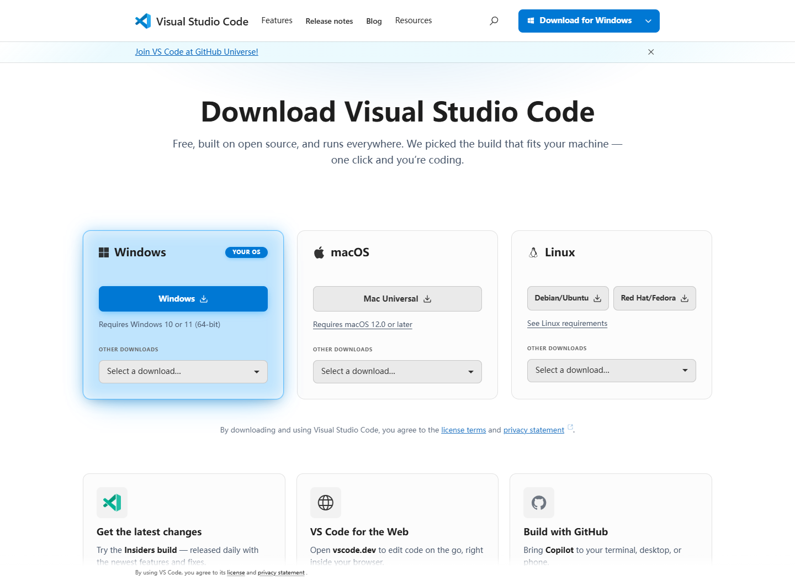

VS Code官方下载页；Windows用户选择User Installer x64。 [官方下载页实拍](https://code.visualstudio.com/download)

1. 打开VS Code，按 `Ctrl+Shift+X` 进入Extensions，搜索 `@id:ritwickdey.LiveServer`，确认扩展名Live Server、发布者Ritwick Dey，点击Install。也可在 `Ctrl+P` 中输入 `ext install ritwickdey.LiveServer` 回车。搜索结果中可能还有Live Preview等扩展，这里选择Live Server即可。

2. File → Open Folder，只选 `material/项目工程/前后端/fronted` 文件夹，打开后应能看到index.html、styles.css、app.js、config.js及.vscode。若出现Workspace Trust提示，确认工程来源后再信任。

3. 打开index.html，右键 → Open with Live Server，或点右下角Go Live。浏览器应打开 `http://127.0.0.1:5500/`。检查地址栏端口；工程的.vscode/settings.json已设置5500。

4. 再开一个VS Code窗口，Open Folder选择 `material/项目工程/纯前端版`，同样Go Live，应在5501打开。右下角端口按钮可以停止服务。

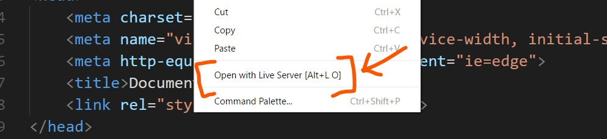

在HTML编辑器中右键，选择Open with Live Server。 [Live Server作者的界面示例](https://marketplace.visualstudio.com/items?itemName=ritwickdey.LiveServer)

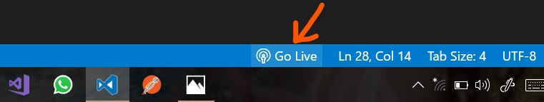

右下角Go Live启动，端口按钮停止；课堂联调页固定5500，纯前端5501。 [Live Server作者的界面示例](https://marketplace.visualstudio.com/items?itemName=ritwickdey.LiveServer)

扩展的官方示例图使用默认5500；本课两个目录分别是5500与5501。来源：[Live Server说明](https://marketplace.visualstudio.com/items?itemName=ritwickdey.LiveServer)。

前端联调版config.js里的 `apiBase` 默认是 `http://127.0.0.1:8080/api`。启动完整后端8080后就能连上；8081只用于SQL填空拓展。课前还没启动后端，联调页暂时请求失败很正常，这一步先确认页面能打开。纯前端版不依赖后端，可以用zhh/demo123完成登录。

**完成标志：** 两个目录各自打开，端口5500/5501正确，纯前端能登录。当前页面是原生HTML/CSS/JavaScript，Live Server足以启动，不需要npm install、Node.js或VS Code的Java调试插件。

[回到准备清单](#before)

<a id="prep-git"></a>

### 07 安装Git，填写提交身份

前几次例会已经用过Git，这次继续用它记录代码修改、管理分支和协作PR。本机工程可以先运行起来，Git放在核心环境之后配置即可。

到[Git官方Windows下载页](https://git-scm.com/install/windows)，选x64 Setup安装程序。这里选择Git本体的安装程序，留意与GitHub Desktop和Git开发SDK区分。安装时大部分选项保留默认；在PATH相关页面选择“Git from the command line and also from 3rd-party software”，让PowerShell和IDEA能找到Git。默认编辑器可以选已安装的VS Code；未看到时保留默认也可，课堂不依赖该选项。

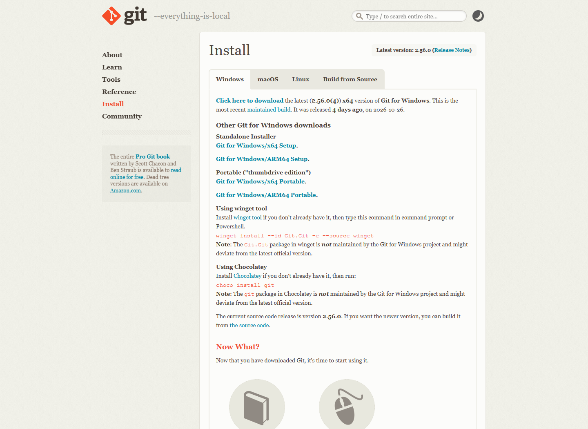

Git官方Windows下载页；选择x64 Setup安装程序。 [官方下载页实拍](https://git-scm.com/install/windows)

安装后重新打开普通PowerShell，先检查版本，再把示例里的姓名和邮箱换成你自己的提交身份：

```powershell
git --version
git config --global user.name "你的姓名或常用昵称"
git config --global user.email "你用于提交的邮箱"
git config --global init.defaultBranch main
git config --global --get user.name
git config --global --get user.email
```

 

`user.name`是提交者名字，不要求与GitHub用户名相同；邮箱会进入提交记录，想保护邮箱可使用GitHub账户设置里的noreply邮箱。这两项用于标记提交者，填写姓名和邮箱即可，GitHub密码与访问token都不用填在这里。

在IDEA Settings → Version Control → Git，Path to Git executable用自动检测到的git.exe，点Test应能识别版本。没有自动找到时，按安装位置选择，例如 `C:\Program Files\Git\cmd\git.exe`。GitHub登录、SSH密钥和远程仓库权限留到实际协作时配置，运行这份本机报名系统不需要它们。[Git首次配置](https://git-scm.com/book/zh/v2/%E8%B5%B7%E6%AD%A5-%E5%88%9D%E6%AC%A1%E8%BF%90%E8%A1%8C-Git-%E5%89%8D%E7%9A%84%E9%85%8D%E7%BD%AE)、[Git for Windows](https://gitforwindows.org/)

[回到准备清单](#before)

<a id="prep-apifox"></a>

### 08 安装Apifox桌面版，导入课堂接口

从[Apifox官方下载入口](https://docs.apifox.com/download)选择Windows桌面客户端，按向导安装并打开。也可以从官网首页点击“免费下载”进入。这里使用桌面客户端，方便直接请求自己电脑上的127.0.0.1。按客户端提示完成账号登录或选择适用的本地使用方式。

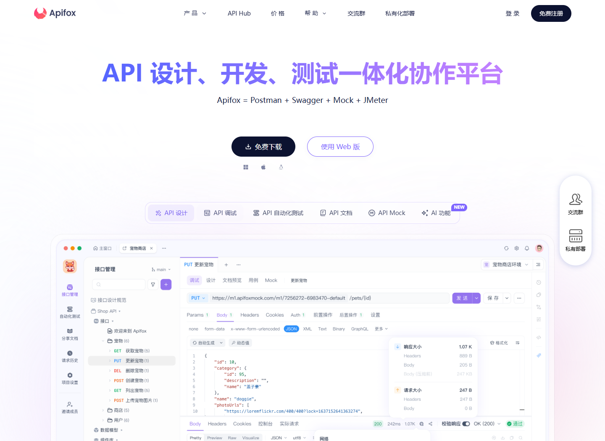

官网的免费下载入口；按系统选择Windows桌面客户端。 [官方下载入口实拍](https://apifox.com/download/)

进入自己的工作空间或团队，新建普通API项目，取名“报名系统课堂练习”。如果创建时询问维护方式，选“以可视化界面维护接口”，方便课堂直接修改请求。进入项目后：

1. 打开“项目设置 → 导入数据”，选择OpenAPI/Swagger。

2. 选择本地文件 `material/apifox相关/基础接口.openapi.json`，查看预览，确认包含注册、登录、活动、报名和查询接口，再确认导入。也可从左侧目录“+ → 导入”进入；界面以自己版本为准。

3. 在右上角创建或切换到“本机练习”环境。主服务前置URL设为 `http://127.0.0.1:8080`，保存并选中它。当前接口路径已经以/api开头，所以此处不再加/api。

4. 打开查询活动接口，查看最终请求地址应为 `http://127.0.0.1:8080/api/events/10`。此时只检查配置，后端在课堂启动后再发送。内存后端8082仅用于前半段演示，后面的接口都请求完整工程8080。

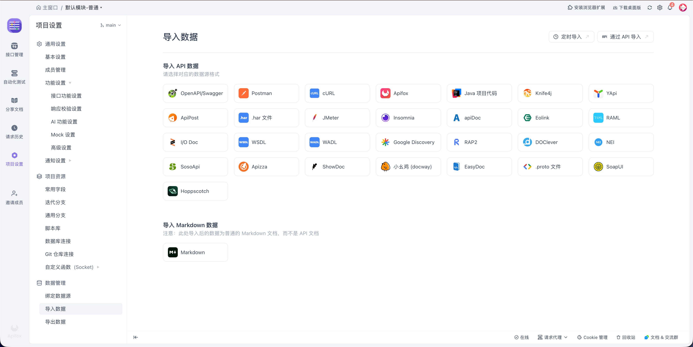

项目设置中的导入数据入口，选择OpenAPI/Swagger。 [Apifox官方界面图](https://docs.apifox.com/manual-import)

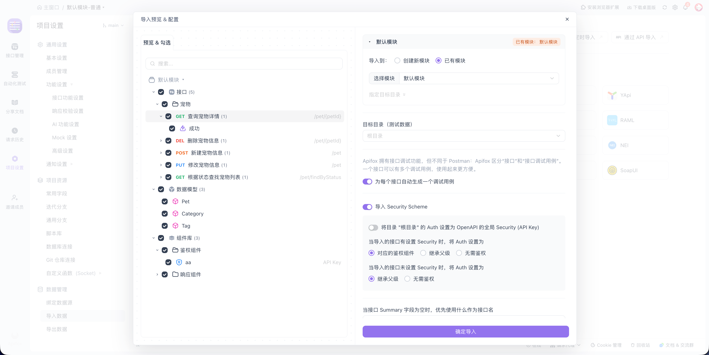

导入文件与选项；本课选择资料中的基础接口.openapi.json。 [Apifox官方界面图](https://docs.apifox.com/manual-import)

**完成标志：** 能打开桌面客户端，课堂接口已出现，当前环境指向8080。token和报名ID留到例会中通过真实请求获取，现在先留空即可。创建环境变量、后置提取和参数传递在[Apifox实操](#apifox)继续讲。[官方导入说明](https://docs.apifox.com/manual-import)

[回到准备清单](#before)

<a id="prep-check"></a>

### 09 最后检查一遍，看看环境准备好了没有

| 检查 | 通过标准 | 不通过回哪里 |
| --- | --- | --- |
| JDK | java与javac显示21，JAVA_HOME指向根目录 | [JDK与环境变量](#prep-jdk) |
| IDEA工程 | pom.xml被识别；Project SDK与Runner为21；依赖同步完成 | [IDEA与Maven](#prep-idea) |
| MySQL服务 | 实际服务状态Running，端口记录清楚 | [MySQL安装与服务](#prep-mysql) |
| 数据库准备 | 准备脚本成功；完整工程能登录和读取活动 | [数据源与SQL](#prep-database) |
| 前端 | 联调页5500、纯前端5501；纯前端zhh/demo123能登录 | [VS Code](#prep-vscode) |
| Git | git --version能运行；提交姓名与邮箱正确 | [Git配置](#prep-git) |
| Apifox | 桌面版能打开；接口导入完成；主服务URL为8080且无重复/api | [Apifox配置](#prep-apifox) |

课前先完成软件安装、依赖下载和数据库连接。建业务表和填SQL属于可选拓展；例会上一起启动完整工程、调试接口。带上电脑与充电器，记好本机MySQL服务名、端口、数据库管理员密码。密码只保存在自己的密码管理工具或本地记录里，不发进公共群，也不要放进共享截图。

遇到问题时，记下卡在哪一步、窗口里的完整报错和当前端口，例会上就更容易定位。全部通过后，回到[今天的流程](#roadmap)；实际运行后端时再按[IDEA运行配置](#java)填写DB_HOST、DB_PORT、DB_NAME、DB_USER、DB_PASSWORD与SERVER_PORT。

<details>
<summary>下载与依赖失败时，按这个顺序排查</summary>

先检查网络、系统时间和下载来源，再查看报错中的域名。除了提前下载IDEA、JDK、Git和MySQL安装包，也记得联网完成Maven依赖、IDEA数据库驱动和VS Code扩展的安装，后面就可以直接动手。

如果某个官网打不开，可以换可用网络，或通过其他可靠渠道获取同一官方来源的安装包。已经配置代理的话，再核对IDEA与Maven实际使用的网络设置。排查时保留HTTPS校验和系统防火墙，从官方来源获取安装包即可，不需要下载“破解版”。本课不要求额外安装Python、全局Maven、Node.js或Apifox CLI；自动检查使用随工程提供的PowerShell脚本。

</details>

[回到准备清单](#before)

<a id="faq"></a>

## 十二、卡住了怎么办？顺着报错找一找

同样的步骤，在自己的电脑上可能会卡在不同地方。先留下完整报错，看看它出现在哪个窗口，再对照下面的表检查。找到具体原因后，通常只需要调整对应的配置或代码，不必从头重装。

### 1. 先看看，是哪一步没有走通？

- **Java没启动起来**：回到IDEA的Run/Debug Console，查看启动日志；如果是构建失败，再看Maven输出。

- **网页打不开或按钮没有反应**：先确认Live Server地址和端口，再看IDEA后端是否仍在运行。

- **请求已经发出，但返回了错误**：在Apifox中保留请求地址、状态码和响应正文。除了404、409这些数字，也看看正文里的code，它能帮助我们区分具体原因。

- **SQL执行失败或查不到数据**：回到IDEA的Query Console，确认当前数据源、数据库和执行结果。

### 2. 找到对应的现象，先检查这一项

| 看到的现象 | 可以先这样查 |
| --- | --- |
| 找不到java或javac | 检查JDK、JAVA_HOME和Path；刚改过环境变量的话，重新打开终端再试 |
| 找不到mvnw.cmd，或构建提示找不到POM | 确认终端位于完整工程根目录，能看到pom.xml与mvnw.cmd；PowerShell中调用当前目录文件要带上 .\ |
| Java启动时提示端口已被占用 | 看IDEA是否还留着旧Run进程；完整后端用8080，练习后端用8081，确认启动的是哪一套 |
| 网页提示Failed to fetch或跨域失败 | 确认后端已启动，apiBase指向完整后端8080，Live Server使用5500，本机CORS配置已加载 |
| SQL不能执行，或查到的库不对 | 确认正在Query Console中操作，选中自己的数据源与当前库；主线是signup_demo，再检查执行结果 |
| 注册返回503、ACCOUNT_SCHEMA_UPDATE_REQUIRED | 旧库的账号表需要升级，按[数据库准备](#database)中的说明，用管理员在对应库执行03脚本 |
| 连接失败，或返回503、DATABASE_NOT_READY | 先查MySQL服务、主机和端口，再核对后端的库名、workshop密码，以及表和SQL是否准备好 |
| 拓展练习返回501、LAB_SQL_REQUIRED | 按提示若正在做旧练习工程，检查两处SQL常量；保存后停止旧进程，再用IDEA重新编译、运行 |
| 返回400、VALIDATION_ERROR | 核对JSON、Content-Type和ID格式；报名正文填 {}，不附带userId |
| 返回401、UNAUTHENTICATED | 检查Bearer Token是否引用有效token；后端刚重启的话，重新登录并更新变量 |
| 返回404、NOT_FOUND | 核对请求路径和方法；新控制器应在正确目录、以.java结尾，并已编译到当前运行的程序中 |
| 返回404、REGISTRATION_NOT_FOUND | 先确认当前账号确实报过这场活动，再检查是否把eventId误传到了userId的位置 |
| 返回409、ALREADY_REGISTERED | 当前账号已经报过名，可以继续查询原记录；需要重做首次报名时，确认当前库后再使用对应重置脚本 |
| 返回409、EVENT_FULL | 活动名额已满，这次请求没有报名成功；查一下报名记录，确认名额由哪些账号占用 |

### 3. 改好了，再做一次刚才的操作

修改配置或参数后，重新发送刚才失败的请求，核对状态码和响应字段。改过Java代码，就先停止旧进程、重新运行，再登录取得新token；涉及写入时，也到MySQL里查一下对应记录。

如果还没解决，保留“卡在哪一步、完整报错、当前请求地址或数据库”的信息，再一起排查，会比只说“运行不了”更容易找到原因。修错前后的请求结果也可以留着，以后碰到相似问题就有参照了。

内存后端8082重启后报名消失，是这个演示版的预期行为；完整后端8080重启后若记录消失，先核对是否连接了同一个数据库。后端重启后的401只说明token失效，需要重新登录后再判断数据是否存在。

<a id="resources"></a>

## 项目入口与参考

- [内存后端说明](%E9%A1%B9%E7%9B%AE%E5%B7%A5%E7%A8%8B/%E5%86%85%E5%AD%98%E5%90%8E%E7%AB%AF%E7%89%88/README.md)、[课前数据库准备脚本](%E5%BF%AB%E9%80%9F%E5%90%AF%E5%8A%A8/%E8%AF%BE%E5%89%8D%E5%87%86%E5%A4%87%E6%95%B0%E6%8D%AE%E5%BA%93.ps1)。

- [前端联调说明](%E9%A1%B9%E7%9B%AE%E5%B7%A5%E7%A8%8B/%E5%89%8D%E5%90%8E%E7%AB%AF/fronted/README.md)、[纯前端页面](%E9%A1%B9%E7%9B%AE%E5%B7%A5%E7%A8%8B/%E7%BA%AF%E5%89%8D%E7%AB%AF%E7%89%88/index.html)：课堂使用5500与5501。

- [操作手册](assets/references/02_%E5%AD%A6%E7%94%9F%E6%93%8D%E4%BD%9C%E6%89%8B%E5%86%8C.md)、[讲解提纲](assets/references/01_%E8%AE%B2%E8%A7%A3%E6%8F%90%E7%BA%B2.md)。

- [基础接口OpenAPI](apifox%E7%9B%B8%E5%85%B3/%E5%9F%BA%E7%A1%80%E6%8E%A5%E5%8F%A3.openapi.json)、新增接口参考、[自动检查脚本](apifox%E7%9B%B8%E5%85%B3/%E8%87%AA%E5%8A%A8%E6%A3%80%E6%9F%A5.ps1)。

- 语言榜单图片与口径说明。

- IDEA官方的[运行程序](https://www.jetbrains.com/help/idea/running-applications.html)、[数据库连接](https://www.jetbrains.com/help/idea/connecting-to-a-database.html)与[执行SQL文件](https://www.jetbrains.com/help/idea/run-sql-files.html)。

- [MySQL Windows安装](https://dev.mysql.com/doc/refman/8.4/en/windows-installation.html)、[Spring REST入门](https://spring.io/guides/gs/rest-service/)。

- Apifox的[导入OpenAPI](https://docs.apifox.com/import-openapi-swagger)、[提取变量](https://docs.apifox.com/extract-variables)与[后置脚本](https://docs.apifox.com/post-request-scripts)。

- [Spec Kit](https://github.com/github/spec-kit)与[SDD概念](https://github.github.com/spec-kit/concepts/sdd.html)。
